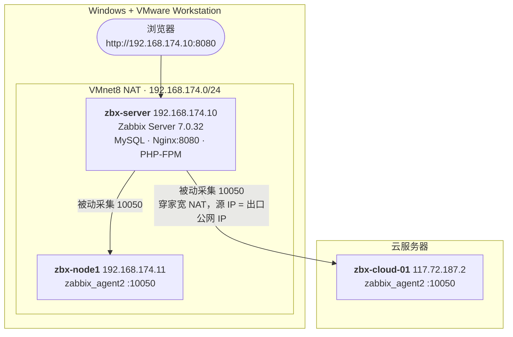

# Zabbix 7.0 LTS 双场景实战

> 在本地 VMware 上用 Ubuntu 24.04 从零搭一套 Zabbix 7.0 LTS，完成「**内网主机**」和「**跨公网云主机**」两种接入。
> 全程实机验证，附一键部署脚本与 6 条真实踩坑复盘。

[](https://www.zabbix.com/)
[](https://ubuntu.com/)
[](https://www.mysql.com/)
[](https://nginx.org/)

---

## 这套东西解决什么问题

很多人学 Zabbix 卡在两个地方：

1. **装不起来** —— 建库少个排序规则、schema 导入报 `ERROR 1418`、前端打开是 `502`，互联网上的教程大多省略了这些前提。
2. **接不进真实主机** —— 尤其是 Server 在家宽 NAT 后面、要监控一台云服务器的时候，Agent 的 `Server=` 到底填什么，几乎所有教程都不讲。

这个仓库把这两条路都走通了，并保留了完整的过程记录。

## 最终形态



一台 Server，两个被监控目标，覆盖了 Zabbix 上手里最典型的两种网络拓扑。

## 实测环境

| 项目 | 版本 / 配置 |
|------|-------------|
| Zabbix | **7.0.32 LTS**（安全支持至 2029-06-30） |
| 系统 | Ubuntu **24.04.5 LTS**，kernel 6.8.0-147 |
| 数据库 | MySQL 8.0.46（schema 导入后 **203 张表**） |
| Web | Nginx 1.24.0 + PHP-FPM 8.3.6 |
| 虚拟机 | VMware Workstation 17.6.3，2C/4G（Server）+ 1C/2G（Node） |
| 镜像 | Ubuntu cloud image（非安装版 ISO），cloud-init 自动配置 |

## 快速开始

### 方式一：脚本一把梭（推荐第二次以后）

```bash
# 1) 在 Zabbix Server 上装服务端
sudo bash scripts/install-zabbix-server.sh

# 2) 在被监控机上装 Agent
#    参数：Agent 看到的「源 IP」 + Web 上要用的主机名
sudo bash scripts/install-zabbix-agent.sh 192.168.174.10 zbx-node1

# 3) 体检
sudo bash scripts/install-zabbix-server.sh --check
```

脚本是幂等的：重复执行不会重导 schema、不会覆盖已有数据。

### 方式二：跟文档手动走（推荐第一次）

| 文档 | 讲什么 | 谁该看 |
|------|--------|--------|
| [**Zabbix 使用手册（小白版）**](docs/Zabbix-使用手册.md) | 装好之后怎么用：看数据、看曲线、改阈值、改采集间隔、加监控项 | **刚上手，只想用起来** |
| [**Zabbix 界面导读（运维视角）**](docs/Zabbix-界面导读.md) | 20 张实机截图走完每个菜单：每个数字什么意思、指标多少算正常、运维每天看什么 | **看得懂界面但看不懂数字** |
| [**Zabbix 7.0 LTS 安装部署实战**](docs/Zabbix-7.0-LTS-安装部署实战.md) | 从零装出来：VM、数据库、服务端、前端、接主机、排错 | 想复现环境 / 搞懂原理 |

三份文档都按「命令 + 为什么 + 预期输出」写，每一步都能自己对上日志。

**登录信息**（两篇通用）：

| 项目 | 值 |
|------|-----|
| Zabbix Web | `http://<服务器IP>:8080` · `Admin` / `zabbix` |
| SSH | `root` / `Zbx_2026_Lab`（或 `zbx` / 同密码） |
| 数据库 | `zabbix` / `Zbx_2026_Lab` |

### 虚拟机层

如果连虚拟机都想从零建（而不是手动点 VMware 向导）：

```bash
python vm-builder/build_vms.py      # 生成 cloud-init 种子 ISO + vmx
python vm-builder/patch_vmx.py      # 修正 PCIe 根桥（见踩坑 1）
python vm-builder/register_vm.py    # 注册进 Workstation 清单
```

## 两种接入方式的核心区别

| | 方案一：内网 VM | 方案二：云主机 |
|---|---|---|
| 网络路径 | VM → VM，同一虚拟交换机 | VM → 家宽 NAT → 公网 → 云 |
| `Server=` 填什么 | Server 的**内网 IP** | **家宽出口公网 IP**（不是 VM 的内网 IP） |
| 额外条件 | 无 | 云安全组放行 `10050` ← 出口 IP/32 |
| 难度 | 低 | 中（坑全在这） |

> **原理**：Agent 校验的是「连过来的那个 IP」。Server 在 NAT 后面时，Agent 看到的是 NAT 后的出口地址。填错了日志里是：
> `connection from "1.2.3.4" rejected, allowed hosts: "x.x.x.x"` —— 括号里那个 IP 才是该填的值。

## 数据采集验证

不是"界面绿了就算成功"，而是核对了真实数值：

```
CPU utilization         0.57 %
Memory utilization     16.61 %
Available memory       1.72 GB
System uptime            911 s
监控项总数                64
```

## 六个真实踩坑（文档 12.6 有完整复盘）

| # | 坑 | 一句话解法 |
|---|---|---|
| 1 | 手写 `.vmx` 缺 `pciBridge0/4/5/6/7`，vmx 进程 `0xc0000005` 崩溃 | hw20 必须补这五段，否则 PCI 槽位被占满、网卡分不到 |
| 2 | `set -o pipefail` + `grep -q` 导致"明明匹配却判断失败" | 改 `grep PAT >/dev/null`，或不开 `pipefail` |
| 3 | cloud image 的 vmdk 是 `streamOptimized` + `RDONLY` | 先 `vdiskmanager -r -t 0` 转可写，再 `-x` 扩容 |
| 4 | Git Bash 把 `/tmp/x` 转成 Windows 路径 | `export MSYS_NO_PATHCONV=1` |
| 5 | 写进 `inventory.vmls` 界面里也不显示 | Workstation 17 要用「文件→打开」开一次才进列表 |
| 6 | 重启 Windows 后 SSH 连不上 | 虚拟机关机了，不是配置丢了；用 `start-vms.cmd` 启动 |

## 目录结构

```
.
├── README.md
├── docs/
│   ├── Zabbix-界面导读.md                  # 运维视角界面图解，20 张截图
│   ├── Zabbix-使用手册.md                  # 小白使用手册，11 章（看数据/改参数）
│   └── Zabbix-7.0-LTS-安装部署实战.md      # 部署主文档，12 章
├── scripts/
│   ├── install-zabbix-server.sh            # 服务端一键部署（幂等）
│   ├── install-zabbix-agent.sh             # Agent 一键部署 + ACL 配置
│   ├── vm-ctl.sh                           # 虚拟机启停/状态/SSH
│   ├── start-vms.cmd                       # Windows 双击启动（后台）
│   ├── stop-vms.cmd
│   └── open-in-vmware.cmd
├── vm-builder/
│   ├── build_vms.py                        # 生成 seed.iso + vmx
│   ├── patch_vmx.py                        # PCIe 根桥补丁
│   ├── register_vm.py                      # 注册进 Workstation 清单
│   └── zabbix.conf.php                     # 前端配置模板
└── screenshots/
```

## 文档目录

| 章节 | 内容 |
|---|---|
| 0 | 总览 + 实际部署状态 |
| 1 | 版本选型（为什么是 7.0 LTS，兼容矩阵） |
| 2 | 架构 + **主动/被动模式对比** |
| 3 | 虚拟机准备、**VMware 打开方式**、**MobaXterm 登录**、**重启后怎么办** |
| 4–5 | 服务端安装、Web 前端初始化 |
| 6 | 方案一：监控内网 VM（含验收清单） |
| 7 | 方案二：监控云主机（含 NAT 与安全组） |
| 8–9 | 全局验收、造告警 |
| 10 | 报错对照表（4 大类） |
| 11 | **简历怎么写 + 面试高频 10 问 + 3 个深水区** |
| 12 | 路径清单、常用命令、脚本说明、**6 条踩坑复盘** |

## 免责声明

- 脚本里的密码 `Zbx_2026_Lab` 仅用于本地实验环境，**生产请自行替换**。
- 云主机接入时请务必用**单 IP 白名单**（`x.x.x.x/32`）而不要 `0.0.0.0/0`，Agent 暴露公网有风险。
- 文档中的 IP、主机名、密码均为实验环境示例，请按自己的环境调整。

## License

MIT
