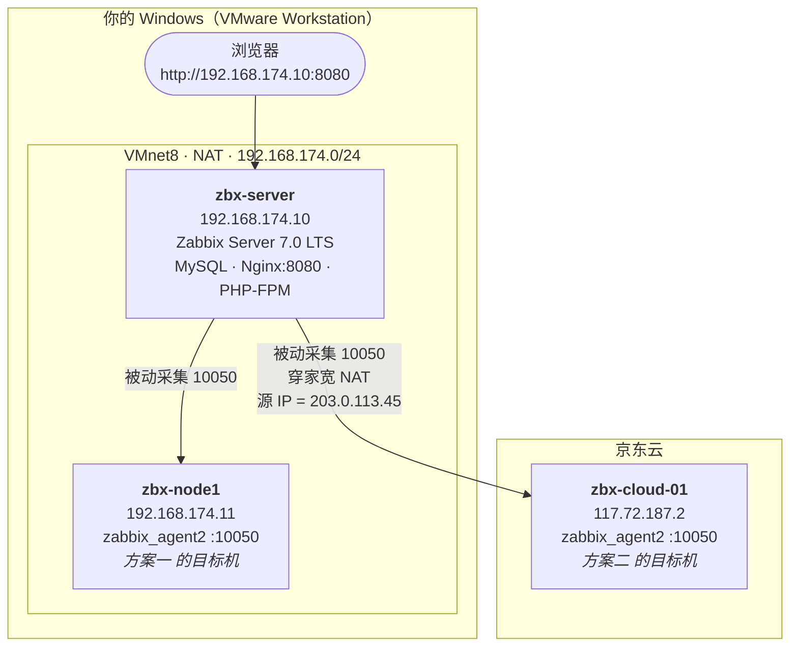
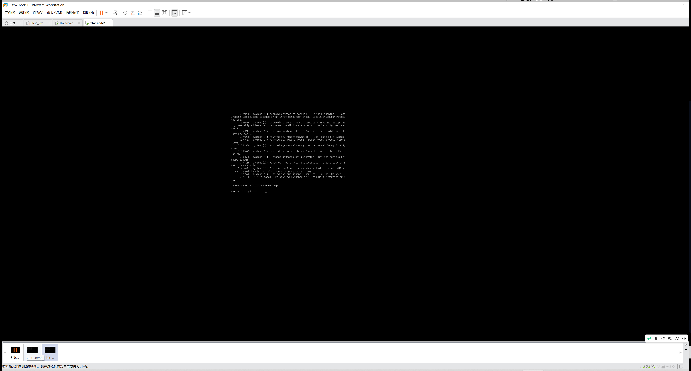
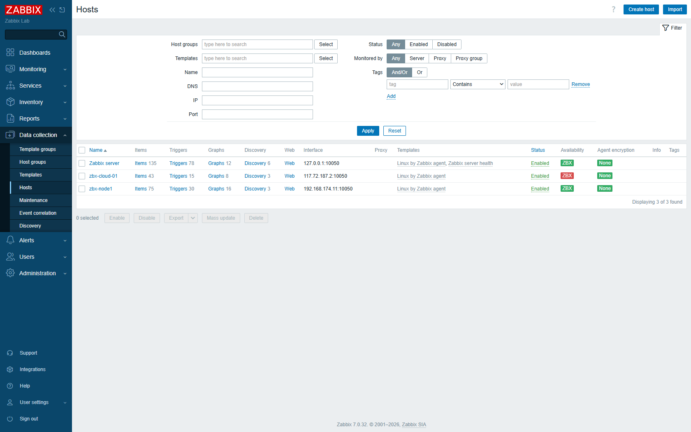
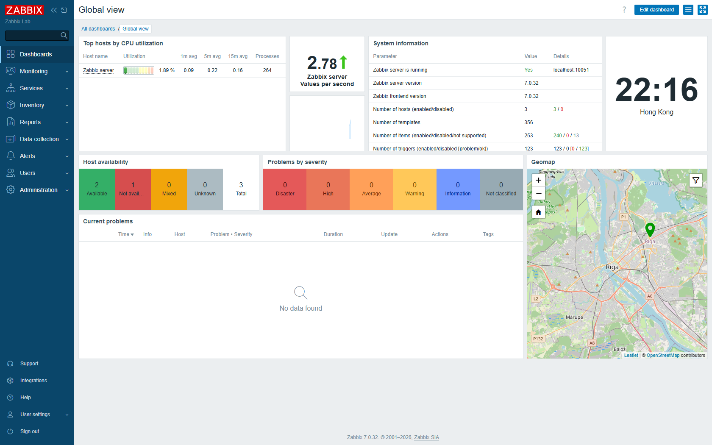
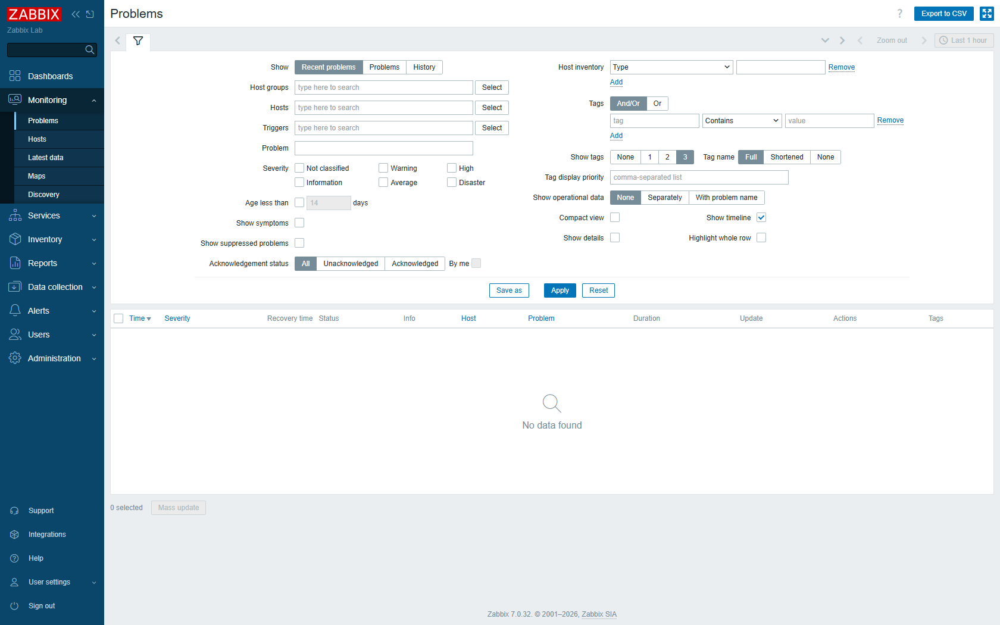
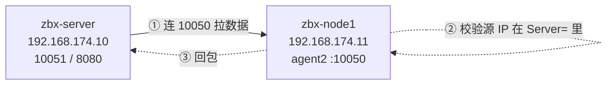

# Zabbix 7.0 LTS 双场景实战

> 🔗 **GitHub 仓库**：<https://github.com/azlove2021/zabbix-lab>
> 包含本文档、一键部署脚本、虚拟机自动化构建脚本与全部截图。
>
> **两个方案都要落地，共用一个 Zabbix 服务端。**
>
> - **方案一**：Server 装在你本地 VMware → 监控 VMware 内的 Ubuntu 虚拟机（内网闭环）
> - **方案二**：同一台 Server → 监控京东云服务器 `117.72.187.2`（跨公网、穿 NAT）
>
> 前者练"标准接入"，后者练"跨网络接入"。这两个能力在简历上价值完全不同，第二个才是能拉开差距的。

---

## 0.0 小白必读：先看这一页

### ① 所有账号密码，一张表搞定

| 你要干什么 | 地址 / 位置 | 用户名 | 密码 |
|---|---|---|---|
| **打开 Zabbix 网页**（最常用） | `http://192.168.174.10:8080` | `Admin` | `zabbix` |
| SSH 登录 **Zabbix 服务器** | `192.168.174.10`，端口 `22` | `root` | `Zbx_2026_Lab` |
| 同上（普通账号，更规范） | `192.168.174.10` | `zbx` | `Zbx_2026_Lab` |
| SSH 登录 **被监控机** | `192.168.174.11`，端口 `22` | `root` | `Zbx_2026_Lab` |
| 连 **Zabbix 数据库** | 在服务器上执行 `mysql -uzabbix -p` | `zabbix` | `Zbx_2026_Lab` |
| **MySQL 管理员** | 在服务器上执行 `sudo mysql` | `root` | **不用密码** |

> ⚠️ **三个密码长得像，千万别搞混：**
>
> | 密码 | 用在哪 | 记住它的特征 |
> |---|---|---|
> | `zabbix` | Zabbix **网页**登录 | 全小写，6 个字母，Zabbix 软件自带的默认密码 |
> | `Zbx_2026_Lab` | **Linux 系统** SSH、数据库 | 首字母大写，有下划线，是我装系统时设的 |
> | 没有密码 | MySQL 的 root | Ubuntu 上 `sudo mysql` 直接进，问了就是没设 |
>
> 网页登录时用户名是 **`Admin`（大写 A）**，密码是 **`zabbix`（全小写）**。这一对最容易输错。

### ② 这份文档现在该看哪一章

这套环境在 **2026-10-27 已经全部装好了**，你现在不需要从头跑一遍：

| 章节 | 状态 | 你要不要看 |
|------|------|-----------|
| 第 1-2 章 | 原理介绍 | 想搞懂"为什么"就看，赶时间可跳 |
| 第 3-5 章 | ✅ 已完成 | **不用再跑**，出问题了回来查 |
| 第 6 章（方案一） | ✅ 已完成 | 不用跑 |
| 第 7 章（方案二） | ⏳ 差一步 | **要做**：云控制台放行 10050 端口 |
| 第 8-10 章 | 验收与排错 | 出问题时查 |
| 第 11 章 | 简历与面试 | 准备面试时看 |
| 第 12 章 | 附录与踩坑 | 想复现环境时看 |

**如果你只是想"用起来"，跳去看 [《Zabbix 使用手册》](Zabbix-使用手册.md)。**
本文档讲的是"怎么把它装出来"，使用手册讲的是"装好之后怎么用"。

### ③ 名词小抄（看不懂术语时回来查）

| 名词 | 英文 | 通俗解释 |
|------|------|----------|
| 主机 | Host | 一台被监控的机器 |
| 监控项 | Item | 要采集的**一个具体指标**，比如"CPU 使用率""根分区剩余空间" |
| 触发器 | Trigger | 判断"这个指标是不是不正常"的规则，比如"CPU > 90% 就报警" |
| 模板 | Template | 把几十个监控项和触发器**打包**，挂到主机上一键生效 |
| 动作 | Action | 报警成立后**要做什么**（发邮件、跑脚本、发 Webhook） |
| 媒介 | Media type | 用**什么方式**通知你（邮件 / Webhook / 短信） |
| 最新数据 | Latest data | 所有指标此刻的数值 |
| 图表 | Graph | 某个指标的历史曲线 |
| 宏 | Macro | 可替换的"参数变量"，形如 `{$MEMORY.UTIL.MAX}`，改它就能改阈值 |

### ④ 三条给新手的提醒

1. **看到红色不要慌**。红色 `ZBX` 只代表"连不上这台机器的 Agent"，最常见原因就三个：机器没开机、防火墙/安全组没放行、`Server=` 填错。
2. **改了配置没反应？** Zabbix 有 60 秒配置缓存，等一分钟；等不及就在服务器上执行 `sudo zabbix_server -R config_cache_reload`。
3. **不要直接改模板里的东西**。模板是所有主机共用的，改了会影响别人。要改就改**自己主机上的"宏"**（第 6 章有例子）。

---

## 目录

- [0.0 小白必读：先看这一页](#00-小白必读先看这一页)
- [0. 总览：你要建的东西长什么样](#0-总览你要建的东西长什么样)
- [1. 版本选型：为什么必须是 7.0 LTS](#1-版本选型为什么必须是-70-lts)
- [2. 架构速览（面试必考）](#2-架构速览面试必考)
- [3. 共同准备：两台 VM + 网络规划](#3-共同准备两台-vm--网络规划)
- [4. 安装 Zabbix Server（两方案公用）](#4-安装-zabbix-server两方案公用)
- [5. Web 前端初始化](#5-web-前端初始化)
- [6. 方案一：监控 VMware 内的 Ubuntu 虚拟机](#6-方案一监控-vmware-内的-ubuntu-虚拟机)
- [7. 方案二：监控京东云服务器](#7-方案二监控京东云服务器)
- [8. 验收：两个方案合起来的样子](#8-验收两个方案合起来的样子)
- [9. 造告警（两方案通用）](#9-造告警两方案通用)
- [10. 报错对照表](#10-报错对照表)
- [11. 简历怎么写 & 面试会问什么](#11-简历怎么写--面试会问什么)
- [12. 附录](#12-附录)

---

## 0. 总览：你要建的东西长什么样

### 0.1 最终形态（一台 Server，两个被监控目标）



**关键点**：两个方案**共用同一台 Zabbix Server**。你不用装两套，方案二只是在方案一的基础上多接一台"远方的机器"。

### 0.2 网络规划表（按你本机 VMware 实际配置）

你机器上的 VMware 网段是实测出来的，不是猜的：

| 角色 | 主机名 | 网络模式 | IP | 说明 |
|------|--------|----------|-----|------|
| 你的 Windows 宿主机 | — | — | `192.168.174.1` | VMnet8 虚拟网卡，浏览器从这访问 Web |
| VMware NAT 网关 | — | — | `192.168.174.2` | 同时是 VM 的 DNS |
| **Zabbix Server** | `zbx-server` | NAT | **`192.168.174.10`** | 两个方案的公共 Server |
| **被监控 VM（方案一）** | `zbx-node1` | NAT | **`192.168.174.11`** | 第二台 Ubuntu |
| **被监控云主机（方案二）** | `zbx-cloud-01` | 公网 | **`117.72.187.2`** | 京东云，agent 已装好 |

为什么选 `.10` / `.11`：你机器上 VMnet8 的 DHCP 池是 **`.128 – .254`**，`.10`、`.11` 在池子外面，不会和自动分配撞车。`.1`（宿主机）和 `.2`（NAT 网关）也不能用。

### 0.3 两个方案的难度对比（心里有个数）

| | 方案一 | 方案二 |
|---|---|---|
| 网络路径 | VM → VM，同一虚拟交换机 | VM → 家宽 NAT → 公网 → 京东云 |
| 主要坑 | 几乎没有 | **`Server=` 填什么**、安全组、家宽 IP 会变 |
| `Server=` 填什么 | `192.168.174.10` | **`203.0.113.45`**（你家宽出口 IP，不是 VM 内网 IP） |
| 预计耗时 | 装完 Server 后 10 分钟 | 15 分钟（前提是安全组能改） |

### 0.4 当前实际部署状态（2026-10-27 已完成）

两台虚拟机已经装好并跑通，**方案一已全程验证通过**，方案二只差你在京东云控制台放行一个端口。

| 项目 | 实际值 |
|------|--------|
| 虚拟机目录 | `D:\VMs\zbx-server\`、`D:\VMs\zbx-node1\` |
| 镜像来源 | 清华镜像 `noble-server-cloudimg-amd64.vmdk`（590,749,696 字节） |
| 系统 | **Ubuntu 24.04.5 LTS**，内核 `6.8.0-147-generic` |
| 磁盘 | 40 GiB / 20 GiB（已由 cloud-init 自动扩展为 38G 根分区） |
| 登录账号 | `root` / `Zbx_2026_Lab`（已开 root 密码登录）· `zbx` / `Zbx_2026_Lab`（sudo 免密） |
| SSH | `ssh root@192.168.174.10` / `ssh root@192.168.174.11`（22 端口，密码认证已开） |
| 虚拟机注册 | 已注册进 Workstation 清单，并已在界面里打开过（顶部有 `zbx-server` / `zbx-node1` 标签，左下角列表也能看到） |
| 一键启动 | 双击 `D:\VMs\start-vms.cmd`（后台启动，不需要开着 VMware 界面） |
| Zabbix | **7.0.32** · MySQL 8.0 · Nginx 1.24.0 · PHP-FPM 8.3 |
| 数据库 | 库 `zabbix` · 用户 `zabbix` / `Zbx_2026_Lab` · **203 张表** |
| Web | **http://192.168.174.10:8080** · `Admin` / `zabbix` |

`Data collection → Hosts` 三台主机：

| 主机 | 接口 | 状态 | 说明 |
|------|------|------|------|
| `Zabbix server` | `127.0.0.1:10050` | 🟢 **ZBX 绿** | 135 items / 78 triggers |
| `zbx-node1` | `192.168.174.11:10050` | 🟢 **ZBX 绿** | 75 items / 30 triggers · **方案一完成** |
| `zbx-cloud-01` | `117.72.187.2:10050` | 🟢 **ZBX 绿** | 68 items · **方案二已打通** |

实测数据（zbx-node1）：CPU 0.57%、内存 16.6%、可用内存 1.72 GB、运行 911 秒 —— 说明采的是真实数据，不是占位值。

> ✅ **方案二已于 2026-10-27 23:44 打通**（`zbx-cloud-01` 变绿，68 个监控项有真实数据）。
>
> **踩到的一个大坑**：京东云**轻量云主机**用的是「**防火墙**」，不是「**安全组**」。
> 在安全组里加了 10050 规则完全不生效——因为轻量云主机根本不走安全组。
> 必须在「轻量云主机 → 实例 → 防火墙」里加规则。
> 判断方法：在云主机上抓包，**一个包都抓不到** = 请求没到机器 = 平台层拦的。

### 部署完成后的界面









---

## 1. 版本选型：为什么必须是 7.0 LTS

写简历最怕版本写错——面试官一句"你怎么不装 LTS"就把你问住了。

| 版本 | 类型 | 当前版本 | 支持到 | 结论 |
|------|------|----------|--------|------|
| **7.0** | **LTS** | 7.0.32（2026-10-20） | 标准支持 2027-06-30，安全支持 **2029-06-30** | ✅ **学习/生产都选这个** |
| 7.4 | 非 LTS | 7.4.16 | 生命周期短，约 1 年 | ❌ 学了就过时 |
| 8.0 | LTS | 8.0 尚未 GA（RC 阶段） | — | ❌ 还没发布 |

**判断规则**：Zabbix 的整版本号（6.0 / 7.0 / 8.0）是 LTS，`x.4`（6.4 / 7.4）是 6 个月一滚的普通版。官方原话："We strongly recommend using only LTS releases in production environments"。

### 版本兼容矩阵（Zabbix 7.0 官方要求）

| 组件 | 支持范围 | Ubuntu 24.04 自带 | 是否符合 |
|------|----------|-------------------|----------|
| MySQL / Percona | 8.0.30 – 9.7.x | mysql-server **8.0.46** | ✅ |
| MariaDB | 10.5.0 – 12.3.x | mariadb-server **10.11.14** | ✅（备选） |
| PostgreSQL | 13.0 – 18.x | 16.x | ✅（备选） |
| PHP | 8.0.0 – 8.5.x | **8.3.6** | ✅ |
| Nginx | 1.20+ | **1.24.0** | ✅ |
| Apache | 2.4+ | 2.4.58 | ✅（本文用 Nginx） |

> 数据库引擎必须是 **InnoDB**；前端最小屏幕宽度 **1200px**。

---

## 2. 架构速览（面试必考）

### 2.1 五个组件

| 组件 | 包名 → 进程 | 作用 | 端口 |
|------|-------------|------|------|
| **Server** | `zabbix-server-mysql` → `zabbix_server` | 采集引擎：取数、算触发器、发告警 | 10051 |
| **Agent 2** | `zabbix-agent2` → `zabbix_agent2` | 装在**被监控机**上，执行具体采集 | 10050 |
| **数据库** | `mysql-server` | 存配置（hosts/items/triggers）+ 历史数据 | 3306 |
| **前端** | `zabbix-frontend-php` | PHP 写的 Web UI，直接读写数据库 | — |
| **Web 服务器** | `zabbix-nginx-conf` + `nginx` + `php8.3-fpm` | 承载前端页面 | 8080 |

**一句话**：Server 负责"取数和判断"，Agent 负责"干活"，DB 负责"记账"，Nginx+PHP 负责"给你看"。

### 2.2 主动模式 vs 被动模式（**两个方案的分水岭**）

| 维度 | 被动模式（Passive） | 主动模式（Active） |
|------|---------------------|---------------------|
| 谁发起连接 | **Server → Agent** 的 10050 | **Agent → Server** 的 10051 |
| Agent 侧校验参数 | `Server=` | `ServerActive=` |
| Web 上选的模板 | `Linux by Zabbix agent` | `Linux by Zabbix agent active` |
| 优点 | 配置简单，随时可测 | 穿 NAT 容易，万级规模省 Server 连接 |
| 缺点 | 每台都要能被 Server 直连 | 采集周期由 Agent 定，Server 不可控 |

**本文两个方案都用被动模式**（更容易讲清链路），主动模式在第 7.7 节作为备选。

**核心规则**：Agent 会校验"**你从哪个 IP 连我**"。Server 在 NAT 后面时，Agent 看到的是 NAT 后的出口公网 IP。写错了就是这条日志：

```log
# /var/log/zabbix/zabbix_agent2.log
2026/10/27 21:25:07.027792 connection from "127.0.0.1" rejected, allowed hosts: "1.2.3.4"
```

（这条是本次在你这台云服务器上真实复现的，不是编的。）

---

## 3. 共同准备：两台 VM + 网络规划

> ✅ **这两台机器已经在 2026-10-27 建好了**，位置 `D:\VMs\zbx-server`、`D:\VMs\zbx-node1`，直接可用。
> 本章保留完整步骤，一是让你知道每步在干什么，二是机器搞坏了可以照着重做。
> 只想马上用的话，跳到 [第 6 章](#6-方案一监控-vmware-内的-ubuntu-虚拟机) 看怎么用。

### 3.1 下载 Ubuntu Server 24.04 ISO

**不要用 Desktop 版**——Server 版省内存，且贴近生产。

用国内镜像（比官网快得多）：

```text
清华： https://mirrors.tuna.tsinghua.edu.cn/ubuntu-releases/24.04/
阿里： https://mirrors.aliyun.com/ubuntu-releases/24.04/
```

下载 `ubuntu-24.04.x-live-server-amd64.iso`（约 2.6 GB，`24.04.x` 的小版本号无所谓，任意一个都行）。

### 3.2 建 VM 1：`zbx-server`（Zabbix 服务端）

VMware Workstation → 文件 → 新建虚拟机。**关键：在第一步选「稍后安装操作系统」**，不要用"安装程序光盘映像文件"的简易安装——简易安装会跳过 Ubuntu 的分区/软件选择界面，后面容易踩奇怪的坑。

| 配置项 | 值 |
|--------|-----|
| 类型配置 | 自定义（高级） |
| 硬件兼容性 | 默认即可 |
| 操作系统 | Linux → **Ubuntu 64 位** |
| 名称 / 位置 | `zbx-server` / 放 D 盘（**别放 C 盘**，快照很吃空间） |
| 处理器 | **2 核** |
| 内存 | **4096 MB** |
| 网络类型 | **NAT** |
| I/O 控制器 | LSI Logic（默认） |
| 磁盘类型 | SCSI（默认） |
| 磁盘 | **40 GB**，**拆分成多个文件** |
| 自定义硬件 | CD/DVD → 使用 ISO 映像文件 → 选你下好的 Ubuntu ISO |

### 3.3 建 VM 2：`zbx-node1`（方案一的被监控机）

同样流程，参数小一点：

| 配置项 | 值 |
|--------|-----|
| 处理器 | **1 核** |
| 内存 | **2048 MB** |
| 磁盘 | **20 GB** |
| 网络 | **NAT** |

> 两台都选 NAT，是因为它们在同一个虚拟交换机上能互访，同时也能上网（apt 装包）。**不要一台 NAT 一台仅主机**，那样要额外配路由。

### 3.4 装系统（两台一样）

开机 → 进 Ubuntu 安装器：

| 步骤 | 选什么 |
|------|--------|
| Language | English（**别选中文**，中文 TTY 下日志会变方块） |
| Installer update | Continue without updating |
| Keyboard | 默认 |
| Type of install | **Ubuntu Server**（不是 Ubuntu Server (minimized)） |
| Network | 先保持 DHCP，装完再改静态（见 3.5） |
| Proxy | 留空 |
| Mirror | 默认 `archive.ubuntu.com` 也能用；慢的话填 `https://mirrors.aliyun.com/ubuntu` |
| Storage | **Use an entire disk**，不勾 LVM，不加密 |
| Profile | name `zbx`；server name `zbx-server` / `zbx-node1`；用户名 `zbx`；密码自己定 |
| **Install OpenSSH server** | ✅ **必须勾**（不然后面没法 SSH） |
| Featured Server Snaps | **一个都不勾**，直接 Done |

装完重启，先 `sudo apt update && sudo apt -y upgrade`。

### 3.5 配静态 IP（两台都要，**很重要**）

动态 IP 会变，一变 `Server=`、安全组、Web 上的主机接口全部失效。VMware 的 DHCP 虽然通常稳定，但学习环境建议写死。

先确认网卡名：

```bash
ip -br link
```

VMware 上通常是 `ens33`（e1000e 网卡）或 `ens160`（vmxnet3）。**下面命令里的 `ens33` 按实际替换。**

```bash
# 先关掉 cloud-init 对网络配置的接管，否则重启会被改回去
sudo tee /etc/cloud/cloud.cfg.d/99-disable-network-config.cfg >/dev/null <<'EOF'
network: {config: disabled}
EOF

# 写静态配置
sudo tee /etc/netplan/50-cloud-init.yaml >/dev/null <<'EOF'
network:
  version: 2
  ethernets:
    ens33:
      dhcp4: false
      addresses: [192.168.174.10/24]
      routes:
        - to: default
          via: 192.168.174.2
      nameservers:
        addresses: [192.168.174.2, 223.5.5.5]
EOF

sudo chmod 600 /etc/netplan/50-cloud-init.yaml
sudo netplan apply
```

> `zbx-node1` 上把 `192.168.174.10` 换成 **`192.168.174.11`**，其余相同。

**验证**：

```bash
ip -4 addr show ens33 | grep inet        # 期望 192.168.174.10/24
ip route | grep default                  # 期望 default via 192.168.174.2
ping -c2 223.5.5.5                       # 能上网
ping -c2 192.168.174.11                  # 在 zbx-server 上能 ping 通另一台
```

> 如果 `netplan apply` 后 IP 没变，先 `sudo reboot`。仍不行就检查网卡名是否写错。

### 3.6 系统基线（两台都做）

```bash
sudo timedatectl set-timezone Asia/Shanghai
sudo apt -y install systemd-timesyncd
sudo systemctl enable --now systemd-timesyncd
timedatectl show -p Timezone -p NTPSynchronized   # NTPSynchronized=yes

sudo apt -y install curl wget vim netcat-openbsd
```

> **时区一定要对**。Zabbix 图表、触发器、日志全靠时间戳，两台机器时区不一致会出现"数据明明有但图上没有"的诡异现象。

### 3.7 立刻打快照

VMware → 虚拟机 → 快照 → 拍摄快照，命名 `clean-ubuntu`。

**这一步千万别省**。装崩了回滚 30 秒，比查错快十倍。两台都打。

### 3.8 在 VMware 里打开虚拟机（**实测踩坑，必读**）

#### 先说结论：Workstation 17 没有「左侧虚拟机列表」

网上很多教程说"左侧列表双击打开"，那是旧版 Workstation 的界面。**17.x 改版了**：

- 虚拟机是**以标签页（Tab）形式**打开的，顶部一排：`主页 | ENsp_Pro | zbx-server | zbx-node1`
- 已注册的虚拟机在**左下角的窄条列表**里（就是那个带图标的细条，右侧有个 `>` 可以展开）
- **关键**：这个列表只会显示"曾经在界面里打开过"的虚拟机。用 `vmrun` 从命令行启动的虚拟机，即使写进了 `inventory.vmls`，也不会自动出现在这里。

所以如果你只看到 `ENs...` 一项、看不到 `zbx-server` / `zbx-node1`，**不是虚拟机没建好，是没在界面里打开过**。

#### 解决办法（三选一，用一次就永久生效）

```text
① 菜单栏「文件(F)」→「打开(O)」→ 选 D:\VMs\zbx-server\zbx-server.vmx
   再重复一次选 zbx-node1.vmx

② 双击 D:\VMs\open-in-vmware.cmd   （我写好的启动器，一次把两台都开进界面）

③ 命令行：vmrun 启动时加 gui 参数
   "C:\Program Files (x86)\VMware\VMware Workstation\vmrun.exe" -T ws start "D:\VMs\zbx-server\zbx-server.vmx" gui
```

打开过一次之后，左下角列表里就会永久有了，以后直接点即可。

> **不要**去手改 `inventory.vmls` 就以为能在界面里看到——清单只决定"注册表里有它"，
> 界面列表还依赖界面自己的最近打开记录。我在这一步浪费了不少时间，你就别踩了。

#### 界面里的三个常用动作

| 想干什么 | 怎么做 |
|----------|--------|
| 看虚拟机的命令行画面 | 点顶部对应标签页 |
| 开机 / 关机 | 标签页里的绿色播放按钮 / 红色电源按钮 |
| 拍快照（**强烈建议**） | 菜单「虚拟机(M)」→「快照」→「拍摄快照」，命名 `clean` |

### 3.9 用 MobaXterm 登录虚拟机

| 项目 | zbx-server | zbx-node1 |
|------|-----------|-----------|
| **主机 IP** | `192.168.174.10` | `192.168.174.11` |
| **端口** | `22` | `22` |
| **用户名** | `root` 或 `zbx` | `root` 或 `zbx` |
| **密码** | `Zbx_2026_Lab` | `Zbx_2026_Lab` |

MobaXterm 操作：`Session` → `SSH` → 填 Remote host 和 Specify username → OK →
首次连接会弹主机指纹，点 `Accept` → 输密码。

**两个账号都能用，区别是：**

| 账号 | 说明 |
|------|------|
| `root` / `Zbx_2026_Lab` | 已额外开启 root 密码登录（**云镜像默认是禁止的**，我加了 `/etc/ssh/sshd_config.d/99-lab-root.conf`）。实验环境图省事用它 |
| `zbx` / `Zbx_2026_Lab` | 普通用户 + `sudo` 免密。**更接近生产习惯**，简历里这么讲更专业 |

命令行验证：

```bash
ssh root@192.168.174.10      # 或 ssh zbx@192.168.174.10
```

连不上的排查顺序：

| 现象 | 原因 |
|------|------|
| 一直转圈然后超时 | 虚拟机没开机 / VMnet8 虚拟网卡被禁用 |
| `Connection refused` | sshd 没起：`systemctl status ssh` |
| `Permission denied` | 密码错（区分大小写），或用了 `root` 但没开 root 登录 |
| `Connection reset` | 同一 IP 上有另一台机器（IP 冲突） |

### 3.10 重启电脑之后怎么办（**SSH 连不上最常见的原因**）

#### 核心规则：虚拟机没开机，就 SSH 不进去

虚拟机的运行状态不跨重启。**Windows 一重启，两台 Ubuntu 就是关机状态**，这时候：

- `ping 192.168.174.10` → 不通
- `ssh root@192.168.174.10` → `Connection timed out`
- Zabbix Web → 打不开

这**不是配置丢了**，是机器没开。磁盘上的数据、Zabbix 数据库、203 张表全都还在。

#### 两种启动方式

**A. 用 VMware 界面**（要顺便看控制台时用）

```text
打开 VMware Workstation → 左下角列表点 zbx-server → 点绿色播放按钮
```

**B. 用脚本一键启动（推荐，不用开界面）**

双击 `D:\VMs\start-vms.cmd`，它会后台启动两台机器（不弹窗口），等 40 秒后打印状态和连接方式。

或者在 Git Bash 里：

```bash
bash vm-ctl.sh start        # 后台启动
bash vm-ctl.sh status       # 看状态
bash vm-ctl.sh stop         # 关机
```

#### 需要先打开 VMware 吗？

**不需要。** 只要虚拟机进程起来了，SSH 就能连：

| 启动方式 | VMware 界面要不要开着 | SSH 能不能连 |
|----------|----------------------|--------------|
| `vmrun ... nogui`（脚本/命令行） | 不用 | ✅ 能 |
| `vmrun ... gui` | 会自己弹窗口 | ✅ 能 |
| VMware 界面点播放按钮 | 要（关了窗口虚拟机仍在跑） | ✅ 能 |

> 也就是说：**VMware 界面开着不是必要条件，虚拟机进程在跑才是。**
> 用 `start-vms.cmd` 启动后把界面关掉，SSH 照样能用。

#### 想开机自动启动（可选）

如果希望登录 Windows 后虚拟机自动起来，把脚本挂到「启动」文件夹或计划任务：

```powershell
# 方法一：放进启动文件夹（登录后执行，最简单）
# Win+R 输入 shell:startup，把 D:\VMs\start-vms.cmd 的快捷方式丢进去

# 方法二：计划任务（登录后 30 秒执行，不弹黑窗口）
schtasks /create /tn "StartZabbixVMs" /tr "D:\VMs\start-vms.cmd" /sc onlogon /delay 0000:30 /rl highest
# 取消：
schtasks /delete /tn "StartZabbixVMs" /f
```

> 我**没有**替你开启自启动——它每次开机要吃 6 GB 内存，你平时不玩 Zabbix 的时候会碍事。
> 想开的时候执行上面任一条即可。

---

## 4. 安装 Zabbix Server（两方案公用）

> 只在 **`zbx-server`（192.168.174.10）** 上执行。`zbx-node1` 和云主机都不装服务端。

### 4.1 添加 Zabbix 7.0 官方源

```bash
cd /tmp
wget https://repo.zabbix.com/zabbix/7.0/ubuntu/pool/main/z/zabbix-release/zabbix-release_latest_7.0+ubuntu24.04_all.deb
sudo dpkg -i zabbix-release_latest_7.0+ubuntu24.04_all.deb
sudo apt update
```

**文件名规则**：`zabbix-release_latest_<主版本>+<发行版版本号>_all.deb`

- `ubuntu24.04` 对应 24.04；22.04 要换成 `ubuntu22.04`
- `_latest_` = 跟随 7.0 分支最新小版本，以后 `apt upgrade` 自动升到 7.0.33、7.0.34…

**验证**：

```bash
apt-cache policy zabbix-server-mysql | head -4
# 期望 Candidate: 1:7.0.32-1+ubuntu24.04
```

`/etc/apt/sources.list.d/zabbix.sources` 里会有**两段**：7.0 启用、6.5 由包自带且 `Enabled: no`（别被吓到，不影响）。

### 4.2 安装服务端全家桶

```bash
sudo apt -y install zabbix-server-mysql zabbix-frontend-php zabbix-nginx-conf \
                    zabbix-sql-scripts zabbix-agent2 zabbix-get
```

**实测（Ubuntu 24.04.2）光服务端四个包就会拉 45 个新包**。关键的几个：

| 包 | 版本 | 说明 |
|----|------|------|
| `zabbix-server-mysql` | 7.0.32 | 采集引擎 |
| `zabbix-frontend-php` | 7.0.32 | Web 前端，落到 `/usr/share/zabbix` |
| `zabbix-nginx-conf` | 7.0.32 | Nginx 站点配置 |
| `zabbix-sql-scripts` | 7.0.32 | 建表 SQL（4.1MB gz） |
| `zabbix-agent2` | 7.0.32 | Agent（Server 自己也要被监控） |
| `zabbix-get` | 7.0.32 | 命令行测试工具，**排错必备** |
| `nginx` | 1.24.0 | Web 服务器 |
| `php8.3-fpm` + 一堆 `php8.3-*` | 8.3.6 | PHP 运行时 |

> `mysql-server` **不在这 45 个包里**，得单独装（下一步）。这是新手最容易漏的——装完发现没有数据库。

**验证**：

```bash
dpkg -l | grep -c '^ii.*zabbix'     # 期望 6
nginx -v                            # nginx/1.24.0 (Ubuntu)
php -v | head -1                    # PHP 8.3.6
```

### 4.3 安装并初始化 MySQL

```bash
sudo apt -y install mysql-server
sudo systemctl enable --now mysql
systemctl is-active mysql                   # active
sudo mysql -e "select version();"           # 8.0.46-0ubuntu0.24.04.4
```

> Ubuntu 上 MySQL 的 `root@localhost` 默认用 **auth_socket** 认证（校验"你是不是系统 root"），所以 `sudo mysql` 免密码进。别被"MySQL 初始密码在哪"的旧文章带偏。

```bash
sudo mysql
```

```sql
create database zabbix character set utf8mb4 collate utf8mb4_bin;
create user zabbix@localhost identified by 'Zbx_2026_Lab';
grant all privileges on zabbix.* to zabbix@localhost;
set global log_bin_trust_function_creators = 1;
quit;
```

**四个细节，每个都有人栽过：**

1. **`collate utf8mb4_bin` 不能省**——Zabbix 需要大小写敏感的排序规则。只写 `utf8mb4` 默认是 `utf8mb4_0900_ai_ci`，导入时会 `Duplicate entry` 中断。
2. **用户必须是 `zabbix@localhost`**——Server 走 Unix socket 连本机 MySQL。
3. **`log_bin_trust_function_creators = 1`**——MySQL 8 默认开 binlog，此时创建**存储函数**会被拒（`ERROR 1418`），Zabbix schema 里有函数。**导完记得关回去**。
4. **密码别用 `Zabbix123`**——简历项目里出现弱密码是扣分项。

### 4.4 导入表结构

```bash
time zcat /usr/share/zabbix-sql-scripts/mysql/server.sql.gz \
  | mysql --default-character-set=utf8mb4 -uzabbix -p'Zbx_2026_Lab' zabbix

sudo mysql -e "set global log_bin_trust_function_creators = 0;"
```

- `--default-character-set=utf8mb4` 必须加，否则中文乱码
- 过程**完全静默**就是成功；有输出反而说明出错了
- 2 核 VM 约 60–90 秒
- 别导错：还有 `mysql/proxy.sql`（Proxy 用）和 `postgresql/server.sql.gz`

**验证**：

```bash
mysql -uzabbix -p'Zbx_2026_Lab' zabbix -Nse \
  "select count(*) from information_schema.tables where table_schema='zabbix';"
```

预期 **203**（实测值）。低于 150 说明导入失败。

### 4.5 配置 Zabbix Server 连数据库

```bash
sudo sed -i 's|^#[[:space:]]*DBPassword=.*|DBPassword=Zbx_2026_Lab|' /etc/zabbix/zabbix_server.conf
grep -n '^DB' /etc/zabbix/zabbix_server.conf
```

期望：

```
105:DBName=zabbix
121:DBUser=zabbix
124:DBPassword=Zbx_2026_Lab
```

> 其他默认值（实测）已经是对的，**不用动**：`LogFile=/var/log/zabbix/zabbix_server.log`、`PidFile=/run/zabbix/zabbix_server.pid`、`Timeout=4`。`DBHost` 不写 = 走本地 socket，性能最好，别改成 `127.0.0.1`。

### 4.6 配置 Nginx

`zabbix-nginx-conf` 包安装时**自动**做了两个软链（实测 postinst 行为，不用你动手）：

```
/etc/nginx/conf.d/zabbix.conf                -> /etc/zabbix/nginx.conf
/etc/php/8.3/fpm/pool.d/zabbix-php-fpm.conf  -> /etc/zabbix/php-fpm.conf
```

你只需**取消两行注释**。原文件前两行是（注意是单个 `#` 加 8 个空格）：

```nginx
server {
#        listen          8080;
#        server_name     example.com;

        root    /usr/share/zabbix;
        index   index.php;
```

```bash
sudo sed -i 's|^#[[:space:]]*listen[[:space:]]*8080;|        listen          8080;|' /etc/zabbix/nginx.conf
sudo sed -i 's|^#[[:space:]]*server_name[[:space:]]*example\.com;|        server_name     _;|' /etc/zabbix/nginx.conf
head -4 /etc/zabbix/nginx.conf
```

> 用 `[[:space:]]` 不用 `\s`，因为 `\s` 是 GNU sed 扩展，busybox/BSD sed 上不生效。

> 想让 80 端口直接访问？把 `8080` 改 `80`，并 `sudo rm /etc/nginx/sites-enabled/default`（否则被默认站点抢占）。**但本文建议保持 8080。**

PHP-FPM 池配置（包内默认值，实测够用，一般不用改）：

```ini
[zabbix]
listen = /var/run/php/zabbix.sock
listen.owner = www-data
pm.max_children = 50
php_value[memory_limit] = 128M
php_value[post_max_size] = 16M
```

### 4.7 启动服务

```bash
sudo nginx -t
sudo systemctl restart zabbix-server zabbix-agent2 nginx php8.3-fpm
sudo systemctl enable  zabbix-server zabbix-agent2 nginx php8.3-fpm
```

**三层验证**：

```bash
# ① 服务状态
systemctl is-active zabbix-server zabbix-agent2 nginx php8.3-fpm   # 四行 active

# ② 端口
ss -tlnp | grep -E '10051|10050|8080'
```

```
LISTEN 0 4096 *:10051 *:*  users:(("zabbix_server",pid=...))
LISTEN 0 4096 *:10050 *:*  users:(("zabbix_agent2",pid=...))
LISTEN 0 511  *:8080  *:*  users:(("nginx",pid=...))
```

```bash
# ③ Server 日志
sudo tail -20 /var/log/zabbix/zabbix_server.log
```

成功标志（这几行必须出现）：

```log
database connection: OK
server #0 started [main process]
Zabbix server started
```

---

### 4.9 安装中文界面（可选，建议装上）

Zabbix 自带中文翻译，但 **Ubuntu 默认不生成中文 locale**，所以语言下拉里能看到「简体中文」却选不了，一选就提示：

> You are not able to choose some of the languages, because locales for them are not installed on the web server.

三条命令解决：

```bash
# ① 打开 zh_CN.UTF-8（去掉 /etc/locale.gen 里那一行的注释）
sudo sed -i 's/^# *zh_CN\.UTF-8 UTF-8/zh_CN.UTF-8 UTF-8/' /etc/locale.gen

# ② 生成 locale
sudo locale-gen

# ③ 重启 PHP-FPM
sudo systemctl restart php8.3-fpm
```

**验证**：

```bash
locale -a | grep zh_CN                          # 期望 zh_CN.utf8
php -r 'echo setlocale(LC_ALL,"zh_CN.UTF-8");'  # 期望 zh_CN.UTF-8
```

然后刷新网页 → `用户设置 → 配置 → 语言` → 简体中文 (zh_CN) → 更新。

**顺手把时区也修了**（PHP 默认 UTC，会让网页上的事件时间差 8 小时）：

```bash
echo 'php_value[date.timezone] = Asia/Shanghai' | sudo tee -a /etc/zabbix/php-fpm.conf
sudo timedatectl set-timezone Asia/Shanghai
sudo systemctl restart php8.3-fpm
```

改完后 `用户设置 → 时区` 应显示 `系统默认 (UTC+08:00) Asia/Shanghai`。

> 完整原理、中英文菜单对照表见《[Zabbix 使用手册](Zabbix-使用手册.md)》第 11 章。

---

## 5. Web 前端初始化

### 5.1 打开网页并登录

**第一步：在浏览器地址栏输入下面这个地址**（在你 Windows 上打开，不是虚拟机里）：

```
http://192.168.174.10:8080
```

**第二步：用下面这组账号密码登录**

| 输入框 | 填什么 | 注意 |
|--------|--------|------|
| **Username**（用户名） | `Admin` | **大写 A**，其余小写 |
| **Password**（密码） | `zabbix` | **全小写**，6 个字母 |

点 **Sign in** 按钮。

> 💡 **这是 Zabbix 软件自带的出厂默认账号**，全世界装的 Zabbix 初始都是这一对。
> 所以装完第一件事应该是改掉它——见 5.3。
>
> 如果提示 `Incorrect user name or password`：
> - 用户名是不是输成了 `admin`（小写）→ 必须是 `Admin`
> - 密码是不是输成了 `Zabbix`（大写）→ 必须是全小写 `zabbix`
> - 大小写都对了还进不去 → 看 5.2 的排查

**第三步：登录成功后你应该看到什么**

- 页面顶部**没有**红色横幅（如果有 `Zabbix server is not running`，说明服务端没起，回 4.7）
- 左侧菜单有 `Monitoring` / `Data collection` / `Alerts` / `Administration` 四组
- 默认停在 `Dashboards` 页

### 5.2 打不开网页或登录不了怎么办

**先自查网页通不通**：

```bash
curl -sI http://127.0.0.1:8080 | head -1     # 期望 HTTP/1.1 200 OK
sudo tail -20 /var/log/nginx/error.log
```

分情况对照：

| 你看到的 | 原因 | 怎么办 |
|----------|------|--------|
| 浏览器一直转圈、最后超时 | 虚拟机没开机，或 IP 输错了 | 双击 `D:\VMs\start-vms.cmd` 启动；确认是 `192.168.174.10` |
| `502 Bad Gateway` | PHP-FPM 没起 | `sudo systemctl restart php8.3-fpm` |
| 浏览器**直接下载**一个 `index.php` 文件 | PHP 没生效 | `sudo systemctl status php8.3-fpm`，看是不是 fail |
| `403 Forbidden` | 目录权限不对 | `sudo chown -R www-data:www-data /usr/share/zabbix` |
| 出现 Zabbix 的"安装向导"而不是登录页 | 前端配置文件丢了 | 见 5.4 |

### 5.3 首次登录后立刻做的 3 件事

```text
① 改密码（重要）
   点左下角头像 / Users → Users → 找到 Admin → Change password
   （顺手把 Authentication 里的 Auto-logout 改成 15m，默认 15s 太烦）

② 确认服务端正常
   页面顶部不该出现红色 "Zabbix server is not running"
   有的话 → Server 进程没起，或 10051 不通，回 4.7

③ 认识四个主菜单（简历上要说得出）
   Monitoring       看数据（Dashboards / Problems / Hosts / Latest data）
   Data collection  配置（Hosts / Templates / Items / Triggers）
   Alerts           告警（Actions / Media types / Users）
   Administration   管理（Proxies / Queue / Users / Housekeeping）
```

登录后你会看到 **1 台主机**：`Zabbix server`（安装时自动创建的本地主机，接口 `127.0.0.1:10050`）。**这就是你的第一台被监控主机**，说明链路已经通了，等 ZBX 变绿即可。

### 5.4 如果走进"安装向导"页面

正常情况下你**不应该**看到安装向导——我在部署时已经直接写好了配置文件，跳过了那 6 步。

如果你确实看到了向导（比如重装了前端），说明这个文件没了：

```bash
sudo ls -l /etc/zabbix/web/zabbix.conf.php
```

有两种处理方式：

**方式 A（快）**：直接用现成的配置模板恢复

```bash
sudo mkdir -p /etc/zabbix/web
sudo cp /tmp/zabbix.conf.php /etc/zabbix/web/zabbix.conf.php   # 模板在仓库 vm-builder/ 下
sudo chown www-data:www-data /etc/zabbix/web/zabbix.conf.php
sudo chmod 640 /etc/zabbix/web/zabbix.conf.php
```

**方式 B（跟着向导点）**：那就按向导走，6 步分别是

| 步骤 | 页面 | 填什么 |
|------|------|--------|
| 1 | Welcome | 语言选 **English**，Next |
| 2 | Check of pre-requisites | 全绿就行；红的按提示 `apt install php8.3-xxx` 后刷新 |
| 3 | Configure DB connection | **Host** `localhost` · **Name** `zabbix` · **User** `zabbix` · **Password** `Zbx_2026_Lab` |
| 4 | Settings | Server name `Zabbix Lab` · Timezone `Asia/Shanghai` · Theme `Dark` |
| 5 | Summary | 核对 |
| 6 | Install | Finish |

> 语言建议保持 **English**。所有报错日志、官方文档、面试术语都是英文，中文界面会让你没法把日志和菜单对上号。

第 3 步报 `Cannot connect to the database`，用命令行同参数试：

```bash
mysql -h localhost -uzabbix -p'Zbx_2026_Lab' zabbix -e "select 1;"
```

命令行能连、向导不能连 → 看 `/etc/zabbix/web/zabbix.conf.php` 有没有生成、`www-data` 有没有读权限。

---

## 6. 方案一：监控 VMware 内的 Ubuntu 虚拟机

### 6.1 目标与拓扑



**要拿到的东西**：Web 上出现一台状态为绿的主机，有 CPU / 内存 / 磁盘 / 网络的历史曲线。

### 6.2 在 `zbx-node1` 上装 Agent

```bash
# 加源（和 Server 上完全一样）
cd /tmp
wget https://repo.zabbix.com/zabbix/7.0/ubuntu/pool/main/z/zabbix-release/zabbix-release_latest_7.0+ubuntu24.04_all.deb
sudo dpkg -i zabbix-release_latest_7.0+ubuntu24.04_all.deb
sudo apt update

# 装 agent + 测试工具
sudo apt -y install zabbix-agent2 zabbix-get
```

### 6.3 改 Agent 配置（**方案一最关键的三行**）

```bash
sudo cp /etc/zabbix/zabbix_agent2.conf /root/zabbix_agent2.conf.bak

# ① 允许谁来拉我 —— 填 Zabbix Server 的 IP
sudo sed -i 's|^Server=.*|Server=192.168.174.10|' /etc/zabbix/zabbix_agent2.conf

# ② 主机名 —— 必须与 Web 上填的 Host name 完全一致
sudo sed -i 's|^Hostname=.*|Hostname=zbx-node1|' /etc/zabbix/zabbix_agent2.conf

# ③ 主动模式暂不用，留着不影响
sudo sed -i 's|^ServerActive=.*|ServerActive=192.168.174.10|' /etc/zabbix/zabbix_agent2.conf
```

> **`Hostname` 大小写、连字符都要和 Web 上一致。** 被动模式其实不校验它，但主动模式校验；养成一致的命名习惯能省掉后面 90% 的"为什么没数据"。

### 6.4 放行防火墙 + 启动

```bash
sudo ufw status                                                  # 默认 inactive 就不用管
sudo ufw allow from 192.168.174.10 to any port 10050 proto tcp   # 如果 active

sudo systemctl restart zabbix-agent2
sudo systemctl enable zabbix-agent2
systemctl is-active zabbix-agent2                # active
ss -tlnp | grep 10050                            # *:10050 在听
```

### 6.5 从 Server 侧验证（**通了再进 Web**）

```bash
# 在 zbx-server（192.168.174.10）上执行
nc -zv -w3 192.168.174.11 10050
# 期望：succeeded!

zabbix_get -s 192.168.174.11 -k agent.ping
# 期望：1
```

**返回 1，说明整条链路（网络 + 端口 + ACL + Agent）全部打通。** 此时再去 Web 加主机，一定会成功。

不同结果的含义：

| 结果 | 含义 | 去哪查 |
|------|------|--------|
| `Connection refused` | agent 没起 / 端口没听 | `systemctl status zabbix-agent2` |
| `Connection timed out` | 网络不通 / 防火墙丢包 | `ping 192.168.174.11`、`ufw status` |
| `Connection reset by peer` + agent 日志有 `rejected` | **ACL 拒绝**，`Server=` 写错 | 改 `Server=` 后 restart |
| 返回 `1` | 全通 ✅ | 去 Web |

### 6.6 在 Web 上添加主机

`Data collection → Hosts → Create host`

| 字段 | 值 |
|------|-----|
| **Host name** | `zbx-node1` ← 必须和 agent 的 `Hostname=` 一致 |
| **Visible name** | `VMware 内 Ubuntu 节点` |
| **Templates** | `Linux by Zabbix agent`（被动模式） |
| **Host groups** | `Linux servers` |
| **Interfaces** | Agent / `192.168.174.11` / `10050` |
| **Description** | 方案一 被监控机 · Ubuntu 24.04 |

点 **Add**。

### 6.7 等 ZBX 变绿

`Data collection → Hosts` 看 **Availability** 列：

| 图标 | 含义 |
|------|------|
| 灰色 `ZBX` | 还没采集过（新建主机就是这样） |
| 绿色 `ZBX` | 采集正常 ✅ |
| 红色 `ZBX` | 悬停看提示，常见 `Connection to "192.168.174.11:10050" failed` |

默认采集间隔 1 分钟，**最多等 1–2 分钟**。急的话：

```bash
sudo zabbix_server -R config_cache_reload
```

### 6.8 看数据

| 菜单 | 看什么 |
|------|--------|
| `Monitoring → Hosts` | 每台主机的 CPU/内存/磁盘 迷你趋势图 |
| `Monitoring → Latest data` | 所有监控项的最新值（选主机过滤） |
| `Monitoring → Latest data → Graphs` | 点 item 的 Graph 看历史曲线 |

### 6.9 方案一验收清单

| # | 检查项 | 在哪查 | 期望 |
|---|--------|--------|------|
| 1 | node1 上 agent 在跑 | `systemctl is-active zabbix-agent2` | `active` |
| 2 | 10050 在听 | `ss -tlnp \| grep 10050` | 有输出 |
| 3 | `Server=` 正确 | `grep '^Server=' /etc/zabbix/zabbix_agent2.conf` | `Server=192.168.174.10` |
| 4 | 端口可达 | 在 Server 上 `nc -zv -w3 192.168.174.11 10050` | `succeeded` |
| 5 | **端到端** | 在 Server 上 `zabbix_get -s 192.168.174.11 -k agent.ping` | **`1`** |
| 6 | Web 上有这台主机 | `Data collection → Hosts` | 存在且 Enabled |
| 7 | ZBX 绿 | 同上 | 绿色 |
| 8 | 有数据在变 | `Monitoring → Latest data` | 数值随时间变化 |
| 9 | 有历史曲线 | `Latest data → Graphs` | 有折线 |

**9 项全绿 = 方案一完成。**

### 6.10 方案一常见问题

| 现象 | 原因 | 解法 |
|------|------|------|
| `zabbix_get` 超时 | 两台不在同一网段 / NAT 配错 | 两台都设成 NAT；`ip route` 看默认网关 |
| `rejected, allowed hosts` | `Server=` 还是默认的 `127.0.0.1` | 改成 `192.168.174.10` |
| ZBX 一直灰 | 主机没 Enable / 模板没挂 | Hosts 列表 Status 列 |
| ZBX 红，提示 timeout | node1 上 ufw 拦了 | `ufw allow from 192.168.174.10 to any port 10050 proto tcp` |
| 有数据但没图 | 时区不对 | 两台都 `timedatectl set-timezone Asia/Shanghai` |
| 重启后 IP 变了 | 静态 IP 没生效 | 检查 netplan 和 cloud-init 禁用文件 |

---

## 7. 方案二：监控京东云服务器

### 7.1 目标与拓扑

这是两个方案里**真正的难点**。核心只有一句话：

> Agent 校验的是"**连过来的那个 IP**"。你的 VM 走家宽 NAT 出去，源地址会被换成**你家宽的公网出口 IP**，不是 VM 的内网 IP。

```
你的 Windows / VM          家宽路由器（NAT）           京东云
192.168.174.10  ────────>  203.0.113.45  ────────>  117.72.187.2:10050
                           ↑ 源 IP 被改成这个         ↑ agent 拿它去比对 Server=
```

### 7.2 先把你家的出口公网 IP 查准

**最可靠的办法是从云服务器上反向看你的 SSH 连接来源**（不要用百度搜"我的IP"，那个可能被 CDN 干扰）：

```bash
# 在云服务器 117.72.187.2 上执行
ss -tn | grep ':22 '
```

本次实测输出（你的 MobaXterm 那条连接）：

```
ESTAB 0 384 [::ffff:172.16.0.3]:22 [::ffff:203.0.113.45]:65100
                                       ↑ 这就是你家宽出口 IP
```

**记下 `203.0.113.45`** —— 方案二全程用它。

> 它是**动态的**，宽带重播号会变。变了以后 agent 会拒绝连接，日志长这样：
> `connection from "1.2.3.4" rejected, allowed hosts: "203.0.113.45"`
> 处理办法见 7.7。

### 7.3 云服务器侧：改 Agent 配置

你这台云主机上 `zabbix-agent2 7.0.32` **已经装好了**（前面会话装的）。当前状态：

```bash
grep -nE '^(Server|ServerActive|Hostname)=' /etc/zabbix/zabbix_agent2.conf
# 82:Server=127.0.0.1
# 137:ServerActive=127.0.0.1
# 148:Hostname=Zabbix server
```

改成（**注意 `Server=` 填的是公网出口 IP**）：

```bash
cp /etc/zabbix/zabbix_agent2.conf /root/zabbix_agent2.conf.bak

# ① 允许你家宽出口 IP 来拉我（保留 127.0.0.1 方便本地自测）
sed -i 's|^Server=.*|Server=127.0.0.1,203.0.113.45|' /etc/zabbix/zabbix_agent2.conf

# ② 主机名
sed -i 's|^Hostname=.*|Hostname=zbx-cloud-01|' /etc/zabbix/zabbix_agent2.conf

systemctl restart zabbix-agent2
systemctl is-active zabbix-agent2
ss -tlnp | grep 10050
```

> 如果这台云主机**没有**装过 agent（比如你重装了系统），先执行：
> ```bash
> cd /tmp
> wget https://repo.zabbix.com/zabbix/7.0/ubuntu/pool/main/z/zabbix-release/zabbix-release_latest_7.0+ubuntu24.04_all.deb
> dpkg -i zabbix-release_latest_7.0+ubuntu24.04_all.deb && apt update
> apt -y install zabbix-agent2 zabbix-get
> ```
> 然后再做上面的配置修改。

### 7.4 云服务器侧：安全组放行 10050

**两道门都要开**，只开一道会卡很久。

**① 京东云控制台 → 安全组 → 入站规则 → 添加规则**

| 协议 | 端口 | 源地址 | 策略 | 说明 |
|------|------|--------|------|------|
| TCP | 10050 | `203.0.113.45/32` | 允许 | 只放行你家 IP |

> **绝对不要填 `0.0.0.0/0`。** Agent 暴露在公网意味着任何人都能拉取数据，配了 `system.run[]` 的话还能执行命令。限源 IP 是必须的——这一点写进简历也是加分项。

**② 主机本机防火墙**

```bash
ufw status
# 如果 active：
ufw allow from 203.0.113.45 to any port 10050 proto tcp

# 如果用 iptables
iptables -I INPUT -p tcp -s 203.0.113.45 --dport 10050 -j ACCEPT
```

> 你这台机器实测 `ufw` 未启用，所以主要靠安全组。

### 7.5 从 Server 侧做三重验证

**在 `zbx-server`（192.168.174.10）上执行**：

```bash
# 第 1 重：VM 能不能出公网
ping -c3 117.72.187.2

# 第 2 重：10050 端口通不通
nc -zv -w5 117.72.187.2 10050
# 期望：Connection to 117.72.187.2 10050 port [tcp/*] succeeded!

# 没有 nc 的话：
timeout 5 bash -c 'cat < /dev/null > /dev/tcp/117.72.187.2/10050' && echo "PORT OPEN"

# 第 3 重（决定性）：真拉一次数据
zabbix_get -s 117.72.187.2 -k agent.ping
# 期望：1
```

**第 3 重返回 `1` = 方案二链路全部打通。**

如果第 2 重通、第 3 重不通，一定是 ACL 拒绝。去云服务器看日志：

```bash
journalctl -u zabbix-agent2 -n 20 --no-pager
tail -20 /var/log/zabbix/zabbix_agent2.log
```

看到 `rejected, allowed hosts: "..."` → 日志里 `connection from` 后面的那个 IP 就是你要填进 `Server=` 的值（**这招能自愈任何 IP 填错的场景**）。

### 7.6 在 Web 上添加云主机

`Data collection → Hosts → Create host`

| 字段 | 值 |
|------|-----|
| **Host name** | `zbx-cloud-01` ← 必须和 agent 的 `Hostname=` 一致 |
| **Visible name** | `京东云 Ubuntu 24.04` |
| **Templates** | `Linux by Zabbix agent` |
| **Host groups** | `Linux servers` |
| **Interfaces** | Agent / **`117.72.187.2`** / `10050` |
| **Description** | 方案二 被监控机 · 2C2G · Ubuntu 24.04.2 |

点 **Add**，等 ZBX 变绿。

### 7.7 出口 IP 变了怎么办

家宽重播号后 `203.0.113.45` 可能变，表现为：**刚才是绿的，突然变红**，agent 日志出现 `rejected, allowed hosts: "203.0.113.45"`。

**处理流程（3 分钟）**：

```bash
# ① 云服务器上查新 IP（看 agent 日志里的 rejected 记录最准）
grep 'rejected' /var/log/zabbix/zabbix_agent2.log | tail -3
# 或看你的 SSH 来源
ss -tn | grep ':22 '

# ② 改成新 IP
sed -i 's|^Server=.*|Server=127.0.0.1,<新IP>|' /etc/zabbix/zabbix_agent2.conf
systemctl restart zabbix-agent2

# ③ 同步改安全组源地址为新 IP/32
```

**三个规避方案，按推荐度**：

| 方案 | 做法 | 评价 |
|------|------|------|
| **A. 就手动改** | 上面三步 | 学习阶段最省事，一个月可能也就变一两次 |
| **B. 改用主动模式** | Agent 主动连 Server:10051；需要路由器把 10051 映射到 VM | 一劳永逸，但要多配一步路由器 |
| **C. 家宽申请固定 IP** | 运营商可办（部分省份免费/低价） | 最正规，但为学习环境不值 |

**主动模式（方案 B）的具体改法**，记下来备用：

```bash
# 云服务器上
sed -i 's|^ServerActive=.*|ServerActive=203.0.113.45|' /etc/zabbix/zabbix_agent2.conf
sed -i 's|^Server=.*|Server=127.0.0.1|' /etc/zabbix/zabbix_agent2.conf   # 被动可以关掉
systemctl restart zabbix-agent2
```

```text
① 路由器：把 10051 端口映射到 192.168.174.10:10051
② Web 上的主机：模板换成 "Linux by Zabbix agent active"
③ 主动模式下 Server 不能"主动去拉"，采集周期由 agent 的
   RefreshActiveChecks 和模板里的 item 间隔决定
```

### 7.8 方案二验收清单

| # | 检查项 | 在哪查 | 期望 |
|---|--------|--------|------|
| 1 | 出口 IP 查准 | 云服务器 `ss -tn \| grep ':22 '` | 记为 X.X.X.X |
| 2 | agent 的 `Server=` | `grep '^Server=' /etc/zabbix/zabbix_agent2.conf` | 含那个 X.X.X.X |
| 3 | agent 在跑 | `systemctl is-active zabbix-agent2` | `active` |
| 4 | 10050 在听 | `ss -tlnp \| grep 10050` | `*:10050` |
| 5 | 安全组放行 | 京东云控制台 | TCP 10050 ← X.X.X.X/32 |
| 6 | 端口可达 | Server 上 `nc -zv -w5 117.72.187.2 10050` | `succeeded` |
| 7 | **端到端** | Server 上 `zabbix_get -s 117.72.187.2 -k agent.ping` | **`1`** |
| 8 | Web 上有这台主机 | `Data collection → Hosts` | `zbx-cloud-01` 存在 |
| 9 | ZBX 绿 | 同上 | 绿色 |
| 10 | 有云主机的数据 | `Latest data` 选 `zbx-cloud-01` | CPU/内存/磁盘/网卡都有值 |
| 11 | 数据是真的 | 云服务器 `free -m` 与 Web 上内存项数值接近 | 说明采的是真实数据 |

**11 项全绿 = 方案二完成。**

### 7.9 方案二常见问题

| 现象 | 原因 | 解法 |
|------|------|------|
| `nc` 超时 | 安全组没放行 / 源 IP 填错 | 控制台核对入站规则 |
| `nc` 通，`zabbix_get` 不通 | **ACL 拒绝**，`Server=` 不对 | 看 agent 日志里 `connection from` 的 IP |
| `cannot read from socket: [104] Connection reset by peer` | 同上，ACL 拒绝的典型报错 | 同上 |
| 昨天好好的今天红了 | 家宽 IP 变了 | 7.7 的三步 |
| Server 这台 VM 上不了外网 | NAT 没配好 / 网关错 | `ip route`、`ping 223.5.5.5` |
| ZBX 绿但没数据 | 模板没挂 / item 被禁用 | `Latest data` 里看有没有 item |

---

## 8. 验收：两个方案合起来的样子

全部完成后，`Data collection → Hosts` 应该有 **3 台**：

| Host name | 接口 | 来源 | 说明 |
|-----------|------|------|------|
| `Zabbix server` | `127.0.0.1:10050` | 安装时自动创建 | Server 自己 |
| `zbx-node1` | `192.168.174.11:10050` | **方案一** | VMware 内 Ubuntu |
| `zbx-cloud-01` | `117.72.187.2:10050` | **方案二** | 京东云 |

三台都绿，就是一个"一台 Server 监控本地 + 云端"的完整监控平台。**这个形态在面试里讲出来，比"装了个 Zabbix"强太多。**

### 8.1 全局验收表

| # | 检查项 | 命令 / 位置 | 期望 |
|---|--------|-------------|------|
| 1 | 三个端口都在听 | `ss -tlnp \| grep -E '10051\|10050\|8080'` | 3 行 |
| 2 | Web 200 | `curl -sI http://192.168.174.10:8080 \| head -1` | `200 OK` |
| 3 | 无 Server 未运行横幅 | 页面顶部 | 无红条 |
| 4 | 3 台主机全绿 | `Data collection → Hosts` | 3 个绿 ZBX |
| 5 | 队列正常 | `Administration → Queue` | 无持续堆积 |
| 6 | Server 自身健康 | 给 `Zabbix server` 挂 `Zabbix server health` 模板 | 有 NVPS 数据 |
| 7 | 能出告警 | 第 9 章 | Problems 有记录 |
| 8 | 开机自启 | `systemctl is-enabled zabbix-server zabbix-agent2 nginx php8.3-fpm` | 4 行 `enabled` |

> **第 5、6 项是"高手项"**。`Queue` 长期堆积说明采集跟不上（pollers 不够）；给 Server 自己挂 `Zabbix server health` 模板能看 NVPS（每秒新增数据点数）——这是 Zabbix 最重要的容量指标，面试聊到"大规模怎么规划"时能接上话。

---

## 9. 造告警（两方案通用）

自带模板的 `CPU utilization is too high` 阈值是 **90% 持续 5 分钟**，演示太慢。先调低：

```text
Data collection → Hosts → zbx-node1（或 zbx-cloud-01）→ Triggers
找到 "CPU utilization is too high"
→ 点进去 → Expression 的持续时间 5m 改成 1m
→ Update
```

然后按 **`sysmon.sh` 同一个思路**打满 CPU：

```bash
# 在 zbx-node1 上（1 核就起 2 个循环）
for i in 1 2; do (while :; do :; done) & done
```

等 1–2 分钟，`Monitoring → Problems` 出现红色告警。

**清理**（注意这个坑）：

```bash
# ❌ 错误：pkill -f 'while :;do :;done' 会把自己这条命令也匹配上杀掉
# ✅ 正确：用字符类规避
ps aux | grep 'wh[i]le' | awk '{print $2}' | xargs -r kill -9
```

> 这个 `pkill` 自匹配的坑我在真实环境踩过，写脚本时特别容易中招。

### 9.1 告警链路（面试必问）


四件套缺一不可：**触发器触发 → 动作匹配 → 媒介类型可用 → 用户配了该媒介**。排查"为什么没收到告警"就按这个顺序。

本地想真跑通，最省事的是用 **Webhook 打到一个本地 HTTP 接口**，比折腾 SMTP 快得多。

---

## 10. 报错对照表

### 10.1 安装阶段

| 现象 | 原因 | 解决 |
|------|------|------|
| `E: Unable to locate package zabbix-server-mysql` | Zabbix 源没加成功 | `ls /etc/apt/sources.list.d/zabbix.sources`，重做 4.1 |
| `dpkg: error ... dependency problems` | `zabbix-release` 版本和系统不匹配 | 24.04 必须用 `+ubuntu24.04` |
| 导入 SQL 报 `ERROR 1418` | MySQL 开了 binlog | `set global log_bin_trust_function_creators = 1;` |
| 导入 SQL 报 `Duplicate entry` | 建库没加 `collate utf8mb4_bin` | `drop database zabbix;` 重建 |
| `Access denied for user 'zabbix'@'localhost'` | grant 没做 / 密码特殊字符 | `sudo mysql` 里重新 grant |

### 10.2 启动阶段

| 现象 | 原因 | 解决 |
|------|------|------|
| 日志 `cannot connect to database` | `DBPassword` 没填/填错 | 改 `/etc/zabbix/zabbix_server.conf` |
| 日志 `Unknown database 'zabbix'` | 没建库 | 重做 4.3 |
| `Job for zabbix-server.service failed` | 看 `journalctl -u zabbix-server -n 50` | 按日志提示 |
| `Address already in use` | 端口被旧进程占 | `ss -tlnp \| grep 10051` 找到 PID kill |
| 页面 `Zabbix server is not running` | Server 没起 / 10051 不通 | `systemctl status zabbix-server` |

### 10.3 Web 访问阶段

| 现象 | 原因 | 解决 |
|------|------|------|
| 8080 打不开 | nginx 没起 / listen 还注释着 | `nginx -t` + `head -4 /etc/zabbix/nginx.conf` |
| **浏览器下载 `index.php` 文件** | PHP-FPM 没生效 | `systemctl status php8.3-fpm`、`ls /var/run/php/zabbix.sock` |
| `502 Bad Gateway` | `zabbix.sock` 不存在 | 启 php8.3-fpm，查 pool.d 软链 |
| `403 Forbidden` | 目录权限 | `chown -R www-data:www-data /usr/share/zabbix` |
| 向导第 2 步有红项 | PHP 扩展缺失 | 照提示装 `php8.3-xxx` 后 restart |
| 登录进不去 | 大小写 | 用户 `Admin`（大写 A），密码 `zabbix`（全小写） |
| 语言选中文时提示 `locales for them are not installed` | 操作系统没生成 `zh_CN.UTF-8` | 见 4.9「安装中文界面」 |
| 网页上的事件时间比本地时间差 8 小时 | PHP 的 `date.timezone` 默认是 UTC | 见 4.9，顺手一起修 |

### 10.4 采集阶段（ZBX 红叉）

| 现象 / 日志 | 原因 | 解决 |
|------|------|------|
| `Connection refused` | Agent 没起 | `systemctl status zabbix-agent2` |
| `Connection timed out` | 防火墙 / 安全组 | ufw + 云安全组 |
| `connection from "x" rejected, allowed hosts: "y"` | **ACL 拒绝，`Server=` 没写发起方 IP** | 把 `x` 填进 `Server=` |
| `Connection reset by peer` | 同上（ACL 拒绝的另一种表现） | 同上 |
| ZBX 一直灰 | 主机没 Enable / 模板没挂 | Hosts 列表 Status 列 |
| 有数据没图 | 时区不一致 | 全部 `Asia/Shanghai` |

### 10.5 三个"看着像 bug 其实不是"

1. **改完触发器/模板不生效** → 配置有缓存，等 60 秒，或 `sudo zabbix_server -R config_cache_reload`
2. **新主机 ZBX 灰了 1 分钟** → 采集周期 60s，正常
3. **Problems 里告警一会儿在一会儿没了** → 值回到阈值下会自动 Resolved，这是正确的

---

## 11. 简历怎么写 & 面试会问什么

### 11.1 别只写"熟悉 Zabbix 的安装部署"

那句话在简历上**零信息量**。要写成"有动作、有环境、有结果"。

**❌ 减分**

```
熟悉 Zabbix 的安装部署。
了解 Zabbix 监控。
```

**✅ 加分（按你的实际完成度挑 2–3 条，两个方案做完正好够）**

```
· 独立完成 Zabbix 7.0 LTS 监控平台搭建（Ubuntu 24.04 + MySQL 8.0 + Nginx + PHP-FPM 8.3），
  覆盖官方源配置、数据库初始化与 schema 导入（203 张表）、Server 与前端联调。

· 完成内网多主机接入：在 VMware 虚拟网络中部署 Server 与被监控节点，
  基于 zabbix_agent2 被动模式实现 CPU/内存/磁盘/网络指标采集与阈值告警。

· 完成跨公网主机接入：解决 NAT 环境下 Agent ACL 白名单、
  云安全组端口收敛（单 IP/32 白名单）与出口 IP 漂移问题，实现云主机纳入统一监控。
```

**要点**：出现**具体版本号**、**具体组件**、**具体数量**、**具体解决的问题**。这四样是"我真的做过"的证据。

> 别编数字。接了 3 台就写 3 台，面试官追问"那 100 台怎么扩展"你能答上来就行。

### 11.2 面试高频 10 问

**Q1. Zabbix 架构由哪几部分组成？**
Server（采集与判断）、Agent（采集执行）、Database（配置+历史）、Web Frontend（PHP）、Web Server（Nginx+PHP-FPM）。大规模再加 Proxy。

**Q2. 主动模式和被动模式的差别？**

| | 被动 | 主动 |
|---|---|---|
| 连接方向 | Server → Agent:10050 | Agent → Server:10051 |
| Agent 校验 | `Server=` | `ServerActive=` |
| 模板 | `Linux by Zabbix agent` | `... active` |
| 适用 | 小规模、内网 | 大规模、跨 NAT |

**Q3. 10050 和 10051 分别是什么？**
10050 = Agent 监听（被动模式 Server 连它）；10051 = Server/Proxy 监听（主动模式 Agent 连它）。

**Q4. 什么时候要 Zabbix Proxy？**
跨机房且 Server 无法直连被监控网段；主机数量大（1000+）采集连接压力大；需要断网续传的本地缓存。

**Q5. Item / Trigger / Action / Media 关系？**
Item 产出数据 → Trigger 求值判断 → Action 匹配 Problem 后执行 → Media type 决定通知方式 → User media 决定通知谁。

**Q6. 触发器表达式怎么读？**
`avg(/host/key,5m)>90` = 最近 5 分钟均值 > 90。常用：`last()`、`avg()`、`min()`/`max()`、`change()`、`nodata()`、`count()`。还有 Problem / Recovery 两段表达式。

**Q7. 告警风暴怎么抑制？**
① 触发器依赖 ② 维护期 ③ 动作里"仅发送一次"/自定义间隔 ④ 事件关联 ⑤ 分级严重度。

**Q8. 数据量大了怎么优化？**
DB 层：独立数据库、SSD、调 `innodb_buffer_pool_size`、TimescaleDB/分区表；
Zabbix 层：调 `StartPollers`/`StartPreprocessors`/`CacheSize`/`ValueCacheSize`、缩短 history 保留、用 trend 替代 history、上 Proxy、关掉不用的自动发现。

**Q9. 怎么监控没有 Agent 的设备？**
SNMP（交换机）、IPMI（带外）、JMX（Java）、`icmpping`、HTTP agent（接口可用性）、`trapper` item + `zabbix_sender`（自定义上报）、`UserParameter`（Agent 上挂脚本）。

**Q10. 装完第一件事做什么？**
改掉默认 `Admin/zabbix`；确认 `Zabbix server is not running` 横幅消失；给 Server 自己挂 `Zabbix server health` 模板。

### 11.3 三个"深水区"（想更亮眼就准备这三个）

1. **`history` vs `trends`**：history 存原始值（秒级，保留短）；trends 存小时级汇总（avg/min/max，保留长）。图表大范围读 trends，小范围读 history。
2. **Housekeeper 干什么**：定期删除过期 history/trends/alarms。单线程清理进程，数据量大时成为瓶颈——这是大规模上 TimescaleDB 的原因。
3. **NVPS（New Values Per Second）**：每秒新增数据点数，Zabbix 最重要的容量指标。`Reports → System information` 可看。规划容量先算 NVPS。

> **额外加分**：你能讲清"跨 NAT 接入时 `Server=` 要填出口公网 IP 而不是内网 IP"，绝大多数候选人答不出来——这是真踩过坑才知道的细节。第 7 章那一整套就是你的素材。

---

## 12. 附录

### 12.1 关键文件路径（全部实测确认）

| 用途 | 路径 |
|------|------|
| Server 主配置 | `/etc/zabbix/zabbix_server.conf` |
| Agent 配置 | `/etc/zabbix/zabbix_agent2.conf` |
| Nginx 站点配置 | `/etc/zabbix/nginx.conf` → 软链 `/etc/nginx/conf.d/zabbix.conf` |
| PHP-FPM 池配置 | `/etc/zabbix/php-fpm.conf` → 软链 `/etc/php/8.3/fpm/pool.d/zabbix-php-fpm.conf` |
| 前端根目录 | `/usr/share/zabbix` |
| 前端生成配置 | `/etc/zabbix/web/zabbix.conf.php` |
| 建表 SQL（MySQL） | `/usr/share/zabbix-sql-scripts/mysql/server.sql.gz`（4.1MB） |
| 建表 SQL（Proxy） | `/usr/share/zabbix-sql-scripts/mysql/proxy.sql` |
| Server 日志 | `/var/log/zabbix/zabbix_server.log` |
| Agent 日志 | `/var/log/zabbix/zabbix_agent2.log` |
| Nginx 日志 | `/var/log/nginx/{access,error}.log` |
| Zabbix 软件源 | `/etc/apt/sources.list.d/zabbix.sources` |
| 仓库签名密钥 | `/usr/share/keyrings/zabbix.gpg` |

### 12.2 常用命令速查

```bash
# ---- 服务 ----
sudo systemctl restart zabbix-server zabbix-agent2 nginx php8.3-fpm
sudo systemctl status  zabbix-server --no-pager -l
journalctl -u zabbix-server -n 50 --no-pager

# ---- 版本 ----
zabbix_server -V | head -3
zabbix_agent2 -V | head -3

# ---- 配置生效 ----
sudo zabbix_server -R config_cache_reload

# ---- 测试采集（排错第一手段）----
zabbix_get -s 192.168.174.11 -k agent.ping     # 方案一
zabbix_get -s 117.72.187.2  -k agent.ping      # 方案二

# ---- 语法检查 ----
sudo nginx -t

# ---- 数据库 ----
mysql -uzabbix -p zabbix -e "select count(*) from hosts;"
mysql -uzabbix -p zabbix -e "select count(*) from history;"
sudo du -sh /var/lib/mysql/zabbix

# ---- 端口 ----
ss -tlnp | grep -E '10050|10051|8080'
```

### 12.3 配套脚本

同目录下有两个脚本：

| 脚本 | 用途 | 用法 |
|------|------|------|
| `D:\VMs\start-vms.cmd` | **双击启动两台虚拟机**（后台，不开界面，自动等 40 秒） | 双击运行 |
| `D:\VMs\stop-vms.cmd` | 双击关机（ACPI 正常关机） | 双击运行 |
| `D:\VMs\open-in-vmware.cmd` | 双击把两台都打开到 VMware 界面里 | 双击运行 |
| `vm-ctl.sh` | 虚拟机的启停/状态/SSH/开 Web（命令行版） | `bash vm-ctl.sh status` / `start` / `stop` / `ssh server` / `web` |
| `install-zabbix-server.sh` | 在 `zbx-server` 上一键装完（幂等） | `sudo bash install-zabbix-server.sh` |
| `install-zabbix-agent.sh` | 在**被监控机**上装 agent 并配好 ACL | `sudo bash install-zabbix-agent.sh <Server_IP> <Hostname>` |

日常最常用的几条：

```bash
bash vm-ctl.sh status          # 看两台机器在不在、端口通不通
bash vm-ctl.sh start           # 后台启动（不开窗口，省内存）
bash vm-ctl.sh start gui       # 要看控制台时用这个
bash vm-ctl.sh stop            # 正常关机（ACPI，推荐）
bash vm-ctl.sh web             # 直接打开 Zabbix 页面
```

两个方案分别这样用：

```bash
# 方案一：在 zbx-node1 上
sudo bash install-zabbix-agent.sh 192.168.174.10 zbx-node1

# 方案二：在京东云 117.72.187.2 上
sudo bash install-zabbix-agent.sh 203.0.113.45 zbx-cloud-01
```

装完脚本会自动跑一次 `zabbix_get` 自检，返回 `1` 才算成功。

> 建议**第一次跟着文档手动走一遍**（学习价值就在这），快照回滚重建时再用脚本。

### 12.4 资源占用参考（实测）

| 组件 | 内存 RSS | 备注 |
|------|----------|------|
| `zabbix_agent2` | ~**21 MB** | 只装 Agent 时非常轻 |
| `zabbix_server` | ~40–80 MB | 1–3 台主机规模 |
| `mysqld` | ~**300–400 MB** | 8.0 默认 buffer pool 128M |
| `nginx` (worker) | ~10 MB | |
| `php8.3-fpm` (5 children) | ~100–150 MB | `pm.max_children=50` 是上限 |
| **合计（Server 单机全栈）** | **约 500–650 MB** | 所以 Server VM 给 4 GB |
| **纯 Agent 节点** | **约 30 MB** | 所以 zbx-node1 给 2 GB 绰绰有余 |

### 12.5 小版本升级 / 卸载

```bash
# 升级（7.0.x → 7.0.y）
sudo apt update
sudo apt -y --only-upgrade install 'zabbix-*'
sudo systemctl restart zabbix-server zabbix-agent2

# 彻底卸载（想重来时）
sudo systemctl stop zabbix-server zabbix-agent2 nginx php8.3-fpm
sudo apt -y purge 'zabbix-*' nginx nginx-common nginx-core
sudo apt -y autoremove --purge
sudo rm -rf /etc/zabbix /var/lib/zabbix /var/log/zabbix /usr/share/zabbix
sudo rm -f /etc/nginx/conf.d/zabbix.conf /etc/php/8.3/fpm/pool.d/zabbix-php-fpm.conf
sudo mysql -e "drop database if exists zabbix; drop user if exists zabbix@localhost;"
```

> 更快的方式：VMware 快照回滚。这就是 3.7 节让你打快照的原因。

---

### 12.6 本次实际部署记录（踩坑复盘）

这一节记录"真动手时"遇到的四个问题。每一个都是文档上查不到、只能靠日志推出来的。

#### 坑 1：VMware 手写 vmx 缺 PCIe 根桥 → vmx 进程崩溃

现象：`vmrun start` 报 `操作被取消`，`vmware.log` 里是 `0xc0000005 (access violation)`。

真正的线索在崩溃前的几行：

```log
[msg.pci.noslotavail] No PCIe slot available for Ethernet0.
E1000PCI: failed to register e1000e device.
E1000: unable to start e1000e Ethernet adapter's PCI.
```

**原因**：手写的 `.vmx` 里没有 `pciBridge0/4/5/6/7` 这几段。正常用向导新建的虚拟机默认会写，手写时漏了就只有根复合体那几个槽，SCSI + SATA + USB + SVGA 先占满，网卡就没位置了。

**解法**：`virtualHW.version = "20"` 时必须补上：

```ini
pciBridge0.present = "TRUE"
pciBridge4.present = "TRUE"
pciBridge4.virtualDev = "pcieRootPort"
pciBridge4.functions = "8"
pciBridge5.present = "TRUE"
pciBridge5.virtualDev = "pcieRootPort"
pciBridge5.functions = "8"
pciBridge6.present = "TRUE"
pciBridge6.virtualDev = "pcieRootPort"
pciBridge6.functions = "8"
pciBridge7.present = "TRUE"
pciBridge7.virtualDev = "pcieRootPort"
pciBridge7.functions = "8"
```

#### 坑 2：`set -o pipefail` + `grep -q` 导致"明明匹配了却判断失败"

部署脚本在"检查软件源是否可用"这一步反复失败，但手工敲同样的命令却能看到 `Candidate: 1:7.0.32`。

**原因**：`apt-cache policy pkg | grep -q "Candidate: 1:"` 里，`grep -q` 一找到匹配就立即退出，上游 `apt-cache` 还没写完就收到 SIGPIPE（退出码 141）。开了 `pipefail` 后整条管道的退出码取最右边的非零值 → **管道返回失败**，于是 `if` 判断为"没匹配"。

**解法**：脚本里改成 `grep PATTERN >/dev/null`（`grep` 不加 `-q` 会把输入读完，不会触发 SIGPIPE），或者干脆不开 `pipefail`。

```bash
# ❌ 有 pipefail 时会误判
set -euo pipefail
if apt-cache policy pkg | grep -q "Candidate: 1:"; then ...

# ✅ 两种都行
set -eu
if apt-cache policy pkg | grep "Candidate: 1:" >/dev/null; then ...
```

> 这个坑在"CI 脚本偶发失败、本地手敲却正常"的场景里特别常见，值得记一下。

#### 坑 3：cloud image 的 vmdk 是只读的 streamOptimized

从镜像站下的 `noble-server-cloudimg-amd64.vmdk` 内嵌描述符是：

```text
createType="streamOptimized"
RDONLY 20971520 SPARSE "call-me-stream.vmdk"
ddb.adapterType = "lsilogic"
```

`RDONLY` + `streamOptimized` 意味着**不能直接挂载当系统盘**。必须先转格式再扩容：

```bash
vmware-vdiskmanager.exe -r "源.vmdk" -t 0 "D:\VMs\zbx-server\disk.vmdk"
vmware-vdiskmanager.exe -x 40GB "D:\VMs\zbx-server\disk.vmdk"
```

`-t 0` 是"单个可增长文件"，转完才能 `-x` 扩容。扩容后 guest 里的分区不会自动变大，靠 cloud-init 的 `growpart` + `resizefs` 在开机时处理——实测确实自动把根分区扩到了 38G。

#### 坑 4：Git Bash 的路径转换会破坏 SFTP 的远端路径

用 Python + paramiko 上传到 `/tmp/xxx.sh`，报 `FileNotFoundError`。原因是 Git Bash 把参数里的 `/tmp/xxx.sh` 按 POSIX 路径转换成了 `C:\Users\...\AppData\Local\Temp\xxx.sh`。

**解法**：`export MSYS_NO_PATHCONV=1`（本机装过 Git Bash 的话，这个坑会反复出现）。

另外 cloud-init 的 `write_files` 写 `/etc/apt/sources.list.d/ubuntu.sources` 会被 apt 模块覆盖，换源要放在 `runcmd` 里或者装完手动改。

#### 坑 5：写进 inventory.vmls 也不代表界面里看得到

现象：把 `vmlist14/15` 追加进 `%APPDATA%\VMware\inventory.vmls`，VMware 启动后甚至自己补上了 `DisplayName` 字段（说明它解析成功了），但界面里依然只有原来那台 `ENsp_Pro`。

**原因**：Workstation 17 的 UI 已经不是"左侧树形列表"了。虚拟机以**标签页**打开，已注册的机器在**左下角窄条列表**里，而这个列表只显示"**曾经在界面里打开过**"的虚拟机。`vmrun` 从命令行启动不会产生这条界面记录。

**解法**：用界面打开一次就行，之后永久生效。

```text
文件(F) → 打开(O) → D:\VMs\zbx-server\zbx-server.vmx
文件(F) → 打开(O) → D:\VMs\zbx-node1\zbx-node1.vmx
```

或者直接双击 `D:\VMs\open-in-vmware.cmd`。

**教训**：`inventory.vmls` 只决定"VMware 认识这台机器"，不决定"界面上列出来"。别以为改完配置文件就万事大吉。

#### 坑 6：重启 Windows 后 SSH 连不上，不是配置丢了

虚拟机运行状态不跨重启。Windows 一重启，两台 Ubuntu 就是关机状态，`ping` 不通、`ssh` 超时、Web 打不开——**但磁盘数据一个字节都没少**。

启动方式：双击 `D:\VMs\start-vms.cmd`（后台，不用开界面），或界面里点绿色播放按钮。详见 3.10。

---

## 附：本指南的事实来源

为了不让你照着错命令白折腾，说明哪些是**实地核对过**的：

| 内容 | 核实方式 |
|------|----------|
| VMnet8 网段 `192.168.174.0/24`、网关 `.2`、DHCP 池 `.128–.254` | 读你本机 `/c/ProgramData/VMware/vmnetdhcp.conf` + `vmnetnat.conf` |
| VMware Workstation 已安装（vmrun 1.17.0）、当前没有任何虚拟机 | `ls` + `vmrun` 实测 |
| 45 个依赖包、php8.3-fpm 8.3.6、nginx 1.24.0 | Ubuntu 24.04.2 上 `apt-get install -s` 模拟安装 |
| nginx.conf / php-fpm.conf / zabbix_server.conf 原文 | 下载 deb → `dpkg -x` 解包读原文 |
| 自动软链行为 | 读包内 `postinst` 脚本 |
| schema 4.1MB、203 张表、模板名 `Linux by Zabbix agent` | 解包 `server.sql.gz` 后 grep |
| `zabbix-agent2` 7.0.32 行为、ACL 拒绝日志原文 | 在云服务器上真实安装并故意配错复现 |
| MySQL 8.0.46 / MariaDB 10.11.14 候选版本 | `apt-cache policy` |
| 你家出口公网 IP `203.0.113.45` | 云服务器 `ss -tn \| grep :22` 反查 |
| 版本支持矩阵（7.0 LTS → 2029-06-30） | Zabbix 官方 requirements 文档 |
| **两台 Ubuntu 虚拟机（24.04.5、内核 6.8、40G/20G 磁盘）** | 本次真实创建并启动，SSH 进 guest 验证 |
| **Zabbix Server 7.0.32 完整安装（203 张表、四服务 active、端口监听）** | 用 `install-zabbix-server.sh` 真跑一遍 |
| **方案一 端到端（zbx-node1 ZBX 变绿、64 个数值项有真实数据）** | Zabbix API 查询实测 |
| **e1000e PCIe 槽位崩溃、pipefail+grep -q 误判、streamOptimized 只读** | 本次真实踩到并修复，见 12.6 |
| 中文界面菜单文案 | 未逐项截图（前端保持英文，与本文一致） |

> 第 5 章的向导页本次被跳过（直接写 `/etc/zabbix/web/zabbix.conf.php`），但 `Admin` / `zabbix` 默认账号与向导产物一致，你手动走一遍也不会冲突。
