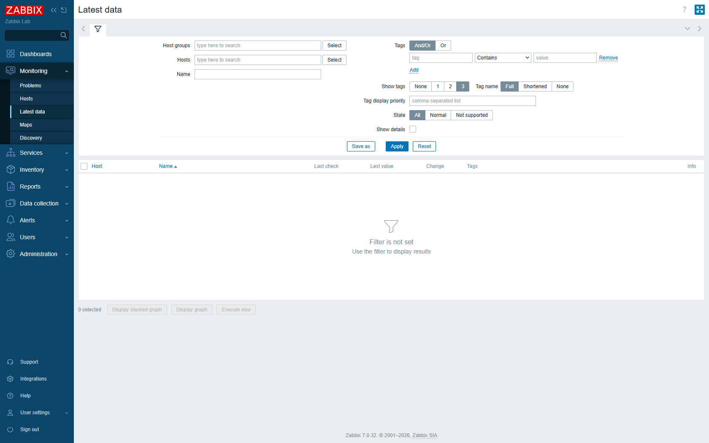
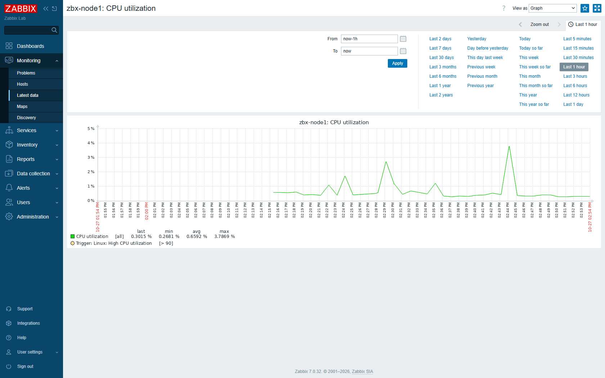
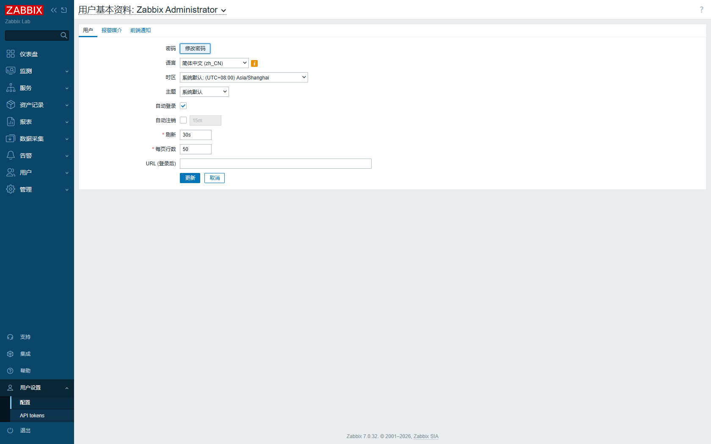

# Zabbix 使用手册（小白版）

> 这篇讲的是「**Zabbix 已经装好了，接下来怎么用它**」。
> 不讲安装、不讲原理，只讲：**在哪儿看数据、怎么改参数**。
>
> 配套文档：[《Zabbix 7.0 LTS 双场景实战》](Zabbix-7.0-LTS-安装部署实战.md)（讲怎么装出来的）
>
> GitHub：<https://github.com/azlove2021/zabbix-lab>

---

## 0. 开始之前，先把这三个信息抄下来

### 0.1 登录信息

| 项目 | 值 |
|------|-----|
| **网址** | `http://192.168.174.10:8080` |
| **用户名** | `Admin`（大写 A） |
| **密码** | `zabbix`（全小写） |

打开浏览器（Chrome / Edge 都行），地址栏粘贴网址，回车。

看到登录框后：用户名填 `Admin`，密码填 `zabbix`，点 **Sign in**。

> 💡 **忘了网页密码怎么办？**
> Zabbix 7.0 的用户密码存的是 **bcrypt 哈希**，不能靠一条 `md5()` 的 SQL 改。
> 在服务器上执行下面三行，可以把 `Admin` 的密码重置成 `zabbix`：
>
> ```bash
> sudo apt -y install apache2-utils        # 提供 htpasswd 命令
> HASH=$(htpasswd -bnBC 10 "" 'zabbix' | tr -d ':\n')
> sudo mysql zabbix -e "UPDATE users SET passwd='$HASH' WHERE username='Admin';"
> ```
>
> 改完直接刷新网页重新登录即可，不用重启任何服务。

### 0.2 现在有几台机器在被监控

| 主机名 | IP | 状态 | 说明 |
|--------|-----|------|------|
| `Zabbix server` | 127.0.0.1 | 🟢 绿 | 服务器自己 |
| `zbx-node1` | 192.168.174.11 | 🟢 绿 | **第二台虚拟机，我们主要看它** |
| `zbx-cloud-01` | 公网 IP | 🟢 绿 | 云服务器（京东云），已打通 |

**这篇手册全程用 `zbx-node1` 做例子**——它就是你 VMware 里的第二台 Ubuntu 虚拟机。

### 0.3 前提：虚拟机得先开机

Zabbix 网页打得开，只说明「服务器那台」在跑。要看 `zbx-node1` 的数据，**它也必须开机**。

```text
双击 D:\VMs\start-vms.cmd        ← 两台一起启动，等 40 秒
```

如果 `zbx-node1` 是关机状态，Zabbix 网页上它的 `ZBX` 会变红，`Latest data` 里全是 `No data`。

---

## 1. 界面长什么样（认准 4 个菜单就够了）

登录后左边一整条竖菜单，分 4 组。**新手只需要记住前两组**：

```
┌─ Monitoring      看数据  ← 90% 的时间在这里
│    ├ Dashboards    总览大屏
│    ├ Problems      当前告警
│    ├ Hosts         主机列表 + 迷你图
│    └ Latest data   所有指标的最新值  ★最常用
│
├─ Data collection 改配置  ← 要改参数时来这里
│    ├ Hosts         主机（点进去能改宏、看监控项、看触发器）
│    └ Templates     模板（全局共用，别乱改）
│
├─ Alerts          告警（谁能收到通知）
└─ Administration  管理（用户、数据保留期）
```

> ⚠️ **一条重要规则**：改参数优先改**主机上的宏（Macros）**，不要改**模板（Templates）**。
> 模板是所有主机共用的，改了会影响其他机器。第 4 章会教你怎么改宏。



*上图就是 `Monitoring → Latest data`，左边是菜单，中间上面是筛选条，下面是数据区*

---

## 2. 看另一台主机的性能数据（核心章节）

### 2.1 三步看到所有指标

```text
第 1 步：点左边 Monitoring → Latest data
第 2 步：在 "Hosts" 输入框里输入 zbx-node1
         → 下面会弹出匹配项 → 用鼠标点它一下（框里出现一个小方块标签）
第 3 步：点右下角的 "Apply" 按钮
```

> **找不到 Apply？** 它在筛选区的右下角，三个按钮 `Save as` / `Apply` / `Reset` 中间那个。
> 点 `Reset` 是清空条件，别点错。

点完 Apply，下面就会出现一张表：

| Host | Name | Last check | Last value | Change |
|------|------|-----------|-----------|--------|
| zbx-node1 | CPU utilization | 22:31:05 | 0.3014569999 | -0.12 |
| zbx-node1 | Memory utilization | 22:31:05 | 16.954 | +0.3 |
| zbx-node1 | Available memory | 22:31:05 | 1713725440 | … |

**每一列是什么意思：**

| 列 | 含义 |
|----|------|
| `Host` | 哪台机器 |
| `Name` | 指标名称（中文界面下可能是中文） |
| `Last check` | 最后一次采集的时间。**这个时间不动 = 采集卡住了** |
| `Last value` | 最新数值 |
| `Change` | 和上一次比变了多少 |
| `Tags` | 标签，新手忽略 |

### 2.2 只想看某一类指标（比如只看 CPU）

在筛选区的 **`Name`** 输入框里输入 `CPU`，再点 **Apply**。

想同时看 CPU 和内存？输入框里可以点 **Add** 再加一条规则。
想还原？点 **Reset**。

> 💡 输入 `CPU` 是"包含匹配"，所以 `CPU utilization`、`CPU load`、`CPU switches` 都会出来。

### 2.3 看历史曲线（最有用的操作）

数字只能看"此刻"，曲线才能看"趋势"。两种进法：

**方法一（推荐，简单）**

```text
1. 在 Latest data 的表格里，勾选最左边的小方框（想多看几条就多勾几个）
2. 点表格下方的 "Display graph" 按钮
3. 弹出图表页
```

**方法二（从主机页进）**

```text
1. 点左边 Monitoring → Hosts
2. 找到 zbx-node1 那一行，点行尾的 "Graphs" 链接
```

打开后你会看到这样一张图：



**这张图怎么用：**

| 你想干什么 | 怎么操作 |
|-----------|---------|
| 换时间范围 | 左上角 `From` / `To` 两个框，比如 From 填 `now-1d`（一天前） |
| 用快捷范围 | 右边一排按钮：`Last 1 hour` / `Last 2 days` / `Last 7 days` / `This month`… |
| 只放大某一段 | 在图上**按住鼠标左键横向拖**，会框选一段 |
| 缩小回去 | 点图右上角 `Zoom out` |
| 看具体数值 | 鼠标悬停在曲线上，会浮出那一刻的数值 |
| 看统计值 | 图下面一行：`last 0.30 %  min 0.26 %  avg 0.65 %  max 3.78 %` |

> **`now-1h` 这种写法**是 Zabbix 的相对时间语法：`now` = 现在，`-1h` = 往前 1 小时。
> 常用：`now-30m`（30 分钟）、`now-1d`（1 天）、`now-7d`（7 天）。

### 2.4 一眼看全所有主机（不用一个个点）

```text
Monitoring → Hosts
```

这张表每行是一台机器，能看到：

- 最右边的 `ZBX` 图标：**绿 = 通的，红 = 连不上，灰 = 还没采集过**
- 中间几列是 CPU / 内存 / 磁盘 的**迷你趋势图**（sparkline），不用点进去就能看出有没有异常

### 2.5 看总览大屏

```text
Monitoring → Dashboards
```

默认的 `Global view` 包含：当前告警列表、有问题的主机、NVPS（每秒采集多少条数据）等。

需要加自己的面板，见第 6 章。

---

## 3. 一条"数据"到底是什么（看懂监控项）

在 `Latest data` 里，如果你点某一行的 `Name`（或从 `Data collection → Hosts → zbx-node1 → Items` 进去），会看到一个监控项的详细配置。**看懂这 5 个字段就够用了**：

| 字段 | 例子 | 含义 |
|------|------|------|
| **Name** | `CPU utilization` | 给人看的名字 |
| **Key** | `system.cpu.util` | 给程序用的标识，**唯一**。改监控内容其实改的是它 |
| **Type of information** | Numeric (float) | 数据类型：数字 / 字符 / 日志 |
| **Units** | `%` | 单位，只是显示用 |
| **Update interval** | `1m` | 多久采集一次。`30s`=30 秒，`1m`=1 分钟，`5m`=5 分钟 |

### 常用的 8 个 Key（记下来很有用）

| Key | 采集什么 |
|-----|---------|
| `system.cpu.util` | CPU 使用率（%） |
| `system.cpu.load[all,avg1]` | 1 分钟平均负载 |
| `vm.memory.utilization` | 内存使用率（%） |
| `vm.memory.size[available]` | 可用内存（字节） |
| `vfs.fs.size[/,pused]` | 根分区使用率（%） |
| `vfs.fs.size[/,pfree]` | 根分区剩余空间（字节） |
| `net.if.in[eth0]` | 网卡 eth0 入流量（bps） |
| `system.uptime` | 开机时长（秒） |

> 这些 Key 可以直接在服务器上用命令测试，不用等网页：
> ```bash
> zabbix_get -s 192.168.174.11 -k system.cpu.util
> zabbix_get -s 192.168.174.11 -k vfs.fs.size[/,pused]
> ```
> **网页上没数据时，先跑这条命令**。命令能出值 = Agent 没问题，问题在 Zabbix 配置；命令报错 = Agent 或网络的问题。

---

## 4. 改参数（新手最想学的部分）

### 4.1 三种改法，先搞清该用哪个

| 你想改什么 | 该改哪里 | 影响范围 | 难度 |
|-----------|---------|---------|------|
| **阈值**（多少算超标） | 主机上的**宏（Macro）** | ✅ 只影响这台主机 | ⭐ 最简单，**推荐** |
| **多久采集一次** | 该监控项的 **Update interval** | 只影响这个指标 | ⭐⭐ |
| **报警条件/持续时间** | 该**触发器（Trigger）**的表达式 | 只影响这条规则 | ⭐⭐⭐ |
| 加一个新的指标 | 新建**监控项（Item）** | 只影响这台主机 | ⭐⭐⭐ |

### 4.2 【最推荐】改阈值：用「宏」覆盖模板默认值

**场景**：默认"内存用到 90% 才报警"，你想改成 80% 就提前知道。

**为什么用宏而不是改触发器**：模板里的触发器写的是 `>{$MEMORY.UTIL.MAX}`，这个 `{$MEMORY.UTIL.MAX}` 就是一个"变量"。你在自己主机上定义同名变量，就会覆盖模板的值，**不用动模板、不影响别的机器**。

**操作步骤：**

```text
第 1 步：点左边 Data collection → Hosts
第 2 步：在列表里点 "zbx-node1" 这个名字（点名字，不是点前面的复选框）
第 3 步：弹出的配置页顶部有一排标签：
         Host | IPMI | Tags | Macros | Inventory | Encryption | Value mapping
         点 "Macros"
第 4 步：你会看到一堆继承自模板的宏，找到 {$MEMORY.UTIL.MAX}，值是 90
第 5 步：往下滚，点 "Add"（新增一条主机自己的宏）
         Macro 填：{$MEMORY.UTIL.MAX}
         Value 填：80
         后面可以填个 Description：内存使用率报警阈值
第 6 步：点右下角 "Update"
第 7 步：等 1 分钟（或执行 zabbix_server -R config_cache_reload）生效
```

**验证改成功了没：**

```text
Monitoring → Hosts → 点 zbx-node1 行尾的 "Triggers"
找到 "Linux: High memory utilization"
点进去看 Expression，如果显示 >{$MEMORY.UTIL.MAX}，
再回 Hosts → Macros 确认是 80，就成了。
```

### 4.3 常用宏默认值一览（照着改就行）

下面这些是从 `Linux by Zabbix agent` 模板里读出来的**真实默认值**：

| 宏 | 默认值 | 意思 | 想更敏感就改成 |
|----|--------|------|---------------|
| `{$MEMORY.UTIL.MAX}` | `90` | 内存使用率超过多少报警（%） | `80` |
| `{$MEMORY.AVAILABLE.MIN}` | `20M` | 可用内存低于多少报警 | `100M` |
| `{$CPU.UTIL.CRIT}` | `90` | CPU 使用率超过多少报警（%） | `80` |
| `{$LOAD_AVG_PER_CPU.MAX.WARN}` | `1.5` | 每核负载超过多少报警 | `1` |
| `{$VFS.FS.PUSED.MAX.CRIT}` | `90` | 分区使用率超过多少**严重**报警（%） | `85` |
| `{$VFS.FS.PUSED.MAX.WARN}` | `80` | 分区使用率超过多少**警告**（%） | `70` |
| `{$VFS.FS.INODE.PFREE.MIN.CRIT}` | `10` | inode 剩余低于多少严重报警（%） | `15` |
| `{$SWAP.PFREE.MIN.WARN}` | `50` | swap 剩余低于多少警告（%） | `30` |
| `{$VFS.DEV.READ.AWAIT.WARN}` | `20` | 磁盘读延迟超过多少 ms 报警 | `10` |

> 带分区参数的宏（如 `{$VFS.FS.PUSED.MAX.CRIT}`）可以针对某个分区单独设：
> `{$VFS.FS.PUSED.MAX.CRIT:"/data"}` → `95`。

### 4.4 改采集间隔（数据太粗或太密）

**场景**：默认 1 分钟一次，你想看更细的曲线。

```text
第 1 步：Data collection → Hosts → 点 zbx-node1 行尾的 "Items"
         （如果看不到 Items 链接，就在 Hosts 列表点主机名进去后找）
第 2 步：用上方的 Name 筛选框输入 CPU，点 Apply
第 3 步：点 "CPU utilization" 这个名字，打开配置
第 4 步：找到 "Update interval"，把 1m 改成 30s
第 5 步：点 Update
```

**间隔怎么写：**

| 写法 | 含义 |
|------|------|
| `30s` | 30 秒 |
| `1m` | 1 分钟 |
| `5m` | 5 分钟 |
| `1h` | 1 小时 |

> ⚠️ **别贪快**。间隔从 1m 改成 30s，数据库体积直接翻倍。
> 一个指标 30 秒采一次，一天就是 2880 条记录；75 个指标就是 21 万条/天。

### 4.5 改触发器的"持续多久才报警"

**场景**：默认"CPU 超过 90% 持续 5 分钟"才报，你觉得太慢，想 1 分钟就报。

```text
第 1 步：Data collection → Hosts → 点 zbx-node1
第 2 步：点 "Triggers" 标签 / 或行尾的 Triggers 链接
第 3 步：找到 "Linux: Load average is too high" 这类触发器，点进去
第 4 步：看 Expression（表达式）那一栏，比如：
         min(/zbx-node1/system.cpu.load[all,avg1],5m)>{$LOAD_AVG_PER_CPU.MAX.WARN}
                                                    ↑ 这个 5m 就是"持续 5 分钟"
第 5 步：把 5m 改成 1m
第 6 步：Update
```

**触发器表达式速读**（看懂了就不怕）：

```
avg(/主机/key,时间范围) > 阈值
 │      │         │        └─ 超过多少算异常
 │      │         └─ 在多长时间内取平均
 │      └─ 取哪个指标
 └─ 函数：last(最新) / avg(平均) / min(最小) / max(最大) / count(次数)
```

几个常见写法：

| 表达式 | 意思是 |
|--------|--------|
| `last(/h/key)>90` | 最新值 > 90 就报警 |
| `avg(/h/key,5m)>90` | 5 分钟平均值 > 90 |
| `min(/h/key,10m)<10` | 10 分钟内最低值 < 10 |
| `nodata(/h/key,5m)=1` | 5 分钟没收到数据就报警（机器失联） |

### 4.6 临时不想让某个指标报警

**场景**：你要重启机器做维护，不想收一堆"Agent 不可用"的告警。

```text
左侧菜单 Data collection → Maintenance → Create maintenance period
  Name: 重启维护
  Maintenance type: With data collection（采集继续）
  Active since / Active till: 选个时间段
  Hosts: 选 zbx-node1
  点 Add → Update
```

> 维护期内，这台主机的告警不会发出去，但数据照常采集，事后还有曲线看。

### 4.7 加一个自己的监控项（进阶，会了很加分）

**场景**：想监控 `/data` 目录用了多少空间（前提是这个目录存在）。

```text
第 1 步：Data collection → Hosts → 点 zbx-node1 行尾的 "Items"
第 2 步：右上角点 "Create item"
第 3 步：填以下 5 项，其余默认：
         Name:              /data 使用率
         Key:               vfs.fs.size[/data,pused]
         Type of information: Numeric (float)
         Units:             %
         Update interval:   1m
第 4 步：点 "Add"
第 5 步：等 1 分钟，去 Monitoring → Latest data 搜 "/data" 看有没有数
```

> `vfs.fs.size[<挂载点>,<模式>]` 的模式：
> `total` 总容量、`used` 已用、`free` 剩余、`pused` 已用百分比、`pfree` 剩余百分比。

**如果 Key 里的路径 Zabbix 采不到**，用命令行先验证：

```bash
zabbix_get -s 192.168.174.11 -k 'vfs.fs.size[/data,pused]'
```

报 `ZBX_NOTSUPPORTED` 就是路径不存在或权限不够。

---

## 5. 告警怎么看、怎么处理

### 5.1 看当前有哪些告警

```text
左侧 Monitoring → Problems
```

每行一条告警，按严重程度排：

| 颜色 | 严重度 | 说明 |
|------|--------|------|
| 灰 | Not classified | 未分类 |
| 蓝 | Information | 提示 |
| 黄 | Warning | 警告 |
| **橙** | **Average** | 一般问题 |
| 红 | High | 严重 |
| 深红 | Disaster | 灾难 |

### 5.2 确认（Ack）一条告警

```text
在 Problems 列表里，点某一行最右边那个 "Ack"（勾号图标）
→ 弹窗里写一句备注，比如"已知道，正在处理"
→ 点 "Acknowledge"
```

**Ack 不是"关闭"，只是告诉团队"有人看过了"**。问题消失后 Zabbix 会自动把它变成 Resolved。

### 5.3 亲手造一个告警（练习用）

想看看告警长什么样，可以人为把 CPU 打满：

```bash
# 在 zbx-node1 上执行（先 SSH 登进去：ssh root@192.168.174.11）
for i in 1 2; do (while :; do :; done) & done
```

等 1-2 分钟，`Monitoring → Problems` 就会出现红色告警。

**玩完记得清理**（这个坑我踩过，`pkill -f 'while'` 会把自己也杀掉）：

```bash
ps aux | grep 'wh[i]le' | awk '{print $2}' | xargs -r kill -9
```

> 如果等了几分钟没告警，是因为默认阈值是「90% 持续 5 分钟」。想快点看到，
> 按 4.5 把持续时间改成 `1m`，或按 4.2 把 `{$CPU.UTIL.CRIT}` 改成 `50`。

---

## 6. 加一张自己的图表

### 6.1 最简单的做法：直接看现成的

按 2.3 的方法勾选几条数据 → `Display graph`，这是"临时图"，关掉就没了。

### 6.2 做一个永久保存的图

```text
第 1 步：Data collection → Hosts → 点 zbx-node1
第 2 步：找 "Graphs"（在主机配置页或行尾链接里）
第 3 步：点 "Create graph"
第 4 步：Name 填：zbx-node1 资源总览
         Graph type: Normal
         Items 里点 "Add"，把这几条加进去：
           CPU utilization
           Memory utilization
           FS [/]: Space used, in %
         每条可以设置颜色和 Draw style（Line / Filled region）
第 5 步：Add
```

以后在 `Monitoring → Hosts → zbx-node1 → Graphs` 就能直接看到这张图。

### 6.3 把图放到首页大屏

```text
Monitoring → Dashboards → 右上角 "Edit dashboard"
→ 点 "Add widget"
→ 类型选 "Graph"，选主机和刚才建的图
→ Apply → 右上角 "Save"
```

---

## 7. 数据存多久？（硬盘会不会被撑爆）

默认配置下，**历史数据存 31 天，趋势数据存 365 天**。

```text
Administration → Housekeeping
```

| 项目 | 默认 | 含义 |
|------|------|------|
| History storage period | 31d | 原始数据（秒级）保留 31 天 |
| Trend storage period | 365d | 小时级汇总保留 365 天 |

**这两者的区别**（面试会问）：

- **History（历史）**：每次采集的原始值，精确但占地方
- **Trend（趋势）**：每小时算一个 avg/min/max，数据量小很多

看图时：时间范围**在历史期内** → 读原始数据；**超过历史期** → 自动读趋势数据。

> 磁盘吃紧就改 `History storage period` 为 `7d`。
> 前提是 `zabbix_server.conf` 里 `HousekeepingFrequency` 没关掉（默认 1 小时跑一次）。

---

## 8. 新手最常见的 10 个问题

**Q1：网页能打开，但 `zbx-node1` 是红叉。**
机器没开机（最常见）→ `ping 192.168.174.11` 试试。通了还红 → SSH 上去 `systemctl status zabbix-agent2`。

**Q2：`Latest data` 里全是 `No data`，但主机是绿的。**
刚加的主机需要 1 分钟才有第一条数据。超过 3 分钟还没有 → 检查模板挂了没：`Data collection → Hosts → zbx-node1`，看 Templates 标签里有没有 `Linux by Zabbix agent`。

**Q3：改了阈值没生效。**
配置有 60 秒缓存。等 1 分钟，或在服务器上跑 `sudo zabbix_server -R config_cache_reload`。

**Q4：图上的时间和电脑上的时间差 8 小时。**
时区问题。服务器执行 `timedatectl set-timezone Asia/Shanghai`，网页里 `Administration → General → Timezone` 也要设成 `Asia/Shanghai`。

**Q5：`Last check` 的时间停在几分钟前不动了。**
采集中断。先在服务器上 `zabbix_get -s 192.168.174.11 -k agent.ping`，返回 1 说明 Agent 正常，问题在 Server 侧（看 `Administration → Queue` 有没有堆积）。

**Q6：找不到 "Graph" 按钮。**
Zabbix 7.0 改成勾选行 → 点下方 `Display graph` 了，没有单独的 Graph 列。

**Q7：能不能只看过去某一天？**
图表页 `From` 填 `2026-10-25 00:00`，`To` 填 `2026-10-25 23:59`。或者用 `now-2d` 到 `now-1d`。

**Q8：改了模板会有影响吗？**
会。模板是所有挂载它的主机共用的。**想只改一台，就改主机上的宏**（4.2）。

**Q9：怎么知道采集频率够不够？**
`Reports → System information` 看 **NVPS**（每秒新增数据点数）。NVPS 突然掉下来 = 采集跟不上。

**Q10：手滑删掉东西了怎么办？**
Zabbix 没有回收站。所以——**改之前先在 VMware 里给虚拟机拍快照**。

---

## 9. 速查表（可以贴在旁边）

### 页面路径

| 想做什么 | 路径 |
|---------|------|
| 看所有指标最新值 | `Monitoring → Latest data` |
| 看历史曲线 | Latest data 勾选 → `Display graph` |
| 看主机总览 | `Monitoring → Hosts` |
| 看当前告警 | `Monitoring → Problems` |
| 改阈值（宏） | `Data collection → Hosts → 点主机名 → Macros` |
| 改采集间隔 | `Data collection → Hosts → 主机 → Items → 点指标名` |
| 改报警条件 | `Data collection → Hosts → 主机 → Triggers` |
| 建维护期 | `Data collection → Maintenance` |
| 改数据保留期 | `Administration → Housekeeping` |
| 看采集队列 | `Administration → Queue` |

### 常用宏

```
{$MEMORY.UTIL.MAX}            90     内存使用率阈值 %
{$CPU.UTIL.CRIT}              90     CPU 使用率阈值 %
{$VFS.FS.PUSED.MAX.CRIT}      90     分区使用率严重阈值 %
{$VFS.FS.PUSED.MAX.WARN}      80     分区使用率警告阈值 %
{$LOAD_AVG_PER_CPU.MAX.WARN}  1.5    每核负载阈值
```

### 常用 Key

```
system.cpu.util                  CPU 使用率 %
vm.memory.utilization            内存使用率 %
vm.memory.size[available]        可用内存 B
vfs.fs.size[/,pused]             根分区使用率 %
net.if.in[eth0]                  网卡入流量
system.uptime                    开机时长 s
```

### 时间格式

```
now          现在
now-30m      30 分钟前
now-1h       1 小时前
now-1d       1 天前
now-7d       7 天前
```

---

## 10. 下一步练什么

按这个顺序练，一天能全过一遍：

1. **看数据**：在 Latest data 里把 `zbx-node1` 的 CPU、内存、磁盘都找出来，各看一次曲线（10 分钟）
2. **改阈值**：把 `{$MEMORY.UTIL.MAX}` 从 90 改成 80，去 Triggers 里验证表达式里的宏变了（10 分钟）
3. **造告警**：打满 CPU，看着 `Problems` 里出现红色，然后 Ack 掉（15 分钟）
4. **改间隔**：把 CPU 采集间隔从 `1m` 改成 `30s`，对比 1 小时后曲线密度（5 分钟）
5. **加监控项**：加一个 `vfs.fs.size[/,pfree]` 剩余空间，设个低于 5G 报警的触发器（20 分钟）
6. **建图表**：把 CPU + 内存 + 磁盘放一张图里，加到 Dashboard（15 分钟）
7. **建维护期**：给自己建一个 10 分钟的维护期，看看告警是不是被抑制了（10 分钟）

练完这 7 步，「会用 Zabbix」这句话就站得住了。

---

> **遇到文档里对不上的地方**：Zabbix 版本不同菜单名会有细微差别，但字段含义一致。
> 实在找不到，用浏览器 `Ctrl+F` 在页面上搜字段名（比如 `Update interval`）。

---

## 11. 附录 A：安装中文界面（含时区修正）

### 11.1 现象

在 `用户设置 → 配置 → 语言` 下拉里能看到「简体中文 (zh_CN)」，但一选就弹黄条：

> You are not able to choose some of the languages, because locales for them are not installed on the web server.
>
> （无法选择部分语言，因为 Web 服务器上没有安装对应的 locale）

### 11.2 原因：不是 Zabbix 缺翻译，是操作系统缺 locale

Zabbix 要显示某种语言，**三个条件必须同时满足**：

| # | 条件 | 在哪一层 | 怎么查 |
|---|------|---------|--------|
| ① | 操作系统生成了该 **locale** | 系统 | `locale -a \| grep zh_CN` |
| ② | PHP 装了 **gettext** 扩展 | PHP | `php -m \| grep gettext` |
| ③ | Zabbix 有该语言的**翻译文件** | 前端目录 | `ls /usr/share/zabbix/locale/zh_CN/LC_MESSAGES/` |

本机实测结果：**② 和 ③ 本来就满足**，只缺 ①。

```bash
$ locale -a | grep zh_CN
（无输出 ← 问题就在这）

$ php -m | grep gettext
gettext

$ ls /usr/share/zabbix/locale/zh_CN/LC_MESSAGES/
frontend.mo          ← 翻译文件有 417 KB，是齐的
```

Ubuntu 默认不会生成中文 locale（`/etc/locale.gen` 里是注释掉的），这是省空间的做法。

### 11.3 安装：三条命令

```bash
# ① 打开 zh_CN.UTF-8（把 /etc/locale.gen 里那一行的 # 去掉）
sudo sed -i 's/^# *zh_CN\.UTF-8 UTF-8/zh_CN.UTF-8 UTF-8/' /etc/locale.gen

# ② 生成 locale
sudo locale-gen

# ③ 重启 PHP-FPM，让网页进程认到新 locale
sudo systemctl restart php8.3-fpm
```

`locale-gen` 的输出应该长这样：

```text
Generating locales (this might take a while)...
  en_US.UTF-8... done
  zh_CN.UTF-8... done
Generation complete.
```

### 11.4 验证

```bash
locale -a | grep zh_CN
# 期望：zh_CN.utf8

php -r 'echo setlocale(LC_ALL, "zh_CN.UTF-8"), PHP_EOL;'
# 期望：zh_CN.UTF-8  （返回 false 说明还没生效，检查是不是漏了第 ③ 步）
```

都通过后，**刷新网页**（不用重启 Zabbix 服务），进
`用户设置 → 配置 → 语言` 选「简体中文 (zh_CN)」→ 点 **更新**。

> 那个黄色警告条会直接消失，不需要改任何 Zabbix 配置。

### 11.5 顺手修一个更隐蔽的问题：时区

装完中文包我顺手看了一眼用户资料页，发现时区是 **`系统默认 (UTC+00:00) UTC`**——这是错的。

**现象**：`当前问题` 里某条告警的时间显示 `14:18:45`，但你实际是 `22:18` 遇到的。**差了 8 小时。**

**原因**：PHP 的 `date.timezone` 默认是 `UTC`，而 Zabbix 网页的所有时间显示都以它为准。
（右上角那个大时钟是浏览器 JS 渲染的，所以它是对的——这个反差很容易让人误判。）

**修法：**

```bash
# ① 让 PHP-FPM 用东八区
echo 'php_value[date.timezone] = Asia/Shanghai' | sudo tee -a /etc/zabbix/php-fpm.conf

# ② 系统时区也确认一下
sudo timedatectl set-timezone Asia/Shanghai

# ③ 重启
sudo systemctl restart php8.3-fpm
```

**验证**：`用户设置 → 配置 → 时区` 应显示 **`系统默认 (UTC+08:00) Asia/Shanghai`**。

修完之后再看 `当前问题`，时间就和你的手表对上了。



*装好之后就是这个样子：语言是「简体中文 (zh_CN)」，时区是「系统默认 (UTC+08:00) Asia/Shanghai」，黄色警告条消失了*

### 11.6 中英文菜单对照表

本文档用的是**英文菜单名**（因为排错日志、官方文档、面试术语都是英文）。
但你装了中文界面之后，屏幕上看到的是中文——用这张表对照：

**左侧主菜单**

| 英文 | 中文 |
|------|------|
| Dashboards | 仪表盘 |
| Monitoring | 监测 |
| ├ Problems | 问题 |
| ├ Hosts | 主机 |
| └ Latest data | 最新数据 |
| Services | 服务 |
| Inventory | 资产记录 |
| Reports | 报表 |
| Data collection | 数据采集 |
| ├ Hosts | 主机 |
| ├ Templates | 模板 |
| └ Maintenance | 维护 |
| Alerts | 告警 |
| ├ Actions | 动作 |
| └ Media types | 报警媒介类型 |
| Users | 用户 |
| Administration | 管理 |
| ├ General | 一般 |
| ├ Housekeeping | 清理 |
| └ Queue | 队列 |

**页面上的字段**

| 英文 | 中文 |
|------|------|
| User profile | 用户基本资料 |
| Password | 密码 |
| Language | 语言 |
| Time zone | 时区 |
| Theme | 主题 |
| Auto-login | 自动登录 |
| Auto-logout | 自动注销 |
| Refresh | 刷新 |
| Rows per page | 每页行数 |
| Update / Cancel | 更新 / 取消 |
| Macros | 宏 |
| Items | 监控项 |
| Triggers | 触发器 |
| Update interval | 更新间隔 |
| Expression | 表达式 |
| Severity | 严重性 |
| Acknowledge (Ack) | 确认 |
| Host availability | 主机可用性 |
| Current problems | 当前问题 |
| System information | 系统信息 |

**告警严重度**

| 英文 | 中文 |
|------|------|
| Not classified | 未分类 |
| Information | 信息 |
| Warning | 警告 |
| Average | 一般严重 |
| High | 严重 |
| Disaster | 灾难 |

### 11.7 想改回英文？

`用户设置 → 配置 → 语言` → 选 `English (en_US)` → 更新。

> 建议：**学习阶段用英文，给同事演示时切中文**。
> 因为搜报错、查官方文档、面试描述都用英文术语，中英对照能帮你两边都对上。

### 11.8 命令行批量设置（不用点界面）

```bash
# 用 API 把 Admin 的语言改成中文
curl -s -X POST http://192.168.174.10:8080/api_jsonrpc.php \
  -H 'Content-Type: application/json-rpc' \
  -d '{"jsonrpc":"2.0","method":"user.login","params":{"username":"Admin","password":"zabbix"},"id":1}'
# 拿到返回值里的 token，再执行：
curl -s -X POST http://192.168.174.10:8080/api_jsonrpc.php \
  -H 'Content-Type: application/json-rpc' \
  -H 'Authorization: Bearer <上一步的token>' \
  -d '{"jsonrpc":"2.0","method":"user.update","params":{"userid":"1","lang":"zh_CN"},"id":2}'
```

> 语言代码表：`en_US` 英文、`zh_CN` 简体中文、`zh_TW` 繁体中文、`ja_JP` 日文。
