# Zabbix 界面导读（运维视角 · 图解版）

> 这篇解决一个问题：**界面上这么多菜单和数字，到底该看哪个？**
>
> 不讲怎么装（看《安装部署实战》），也不讲基础操作（看《使用手册》）。
> 这篇讲的是：**每个页面是干什么的、上面的数字代表什么、运维真正关心哪些。**
>
> 全部截图取自你正在跑的这套环境（3 台主机、中文界面）。

---

## 0. 开始前

| 项目 | 值 |
|------|-----|
| 地址 | `http://192.168.174.10:8080` |
| 账号 | `Admin` / `zabbix` |

**建议的读法**：把这篇文档和浏览器并排，看到哪一节就点开对应的菜单，对着图看自己的屏幕。

---

## 1. 先建立全局印象：左侧 9 个菜单各管什么

登录后左边一竖排，只有 9 项。**记住这张表，界面就再也不会迷路了**：

| 菜单 | 中文 | 干什么 | 运维用它干嘛 |
|------|------|--------|-------------|
| **Dashboards** | 仪表盘 | 总览大屏 | ⭐ 每天上班第一眼看这里 |
| **Monitoring** | 监测 | 看**数据**（只读） | ⭐⭐⭐ 90% 的时间在这 |
| ├ Problems | 问题 | 当前/历史告警 | ⭐⭐⭐ 出事了先看这里 |
| ├ Hosts | 主机 | 主机列表 + 迷你图 | ⭐⭐ 快速扫一遍谁不正常 |
| ├ Latest data | 最新数据 | 所有指标的最新值 | ⭐⭐⭐ 定位具体指标 |
| ├ Graphs | 图形 | 历史曲线 | ⭐⭐ 看趋势 |
| └ Discovery | 自动发现 | 自动扫描到的设备 | 后期用 |
| **Services** | 服务 | 业务视角的服务树 | 大公司才配，学习可跳过 |
| **Inventory** | 资产记录 | 主机的 CMDB 信息 | 记录机型/机房/负责人 |
| **Reports** | 报表 | 系统信息 / 可用性 / 审计 | ⭐⭐ 复盘、写周报 |
| **Data collection** | 数据采集 | 改**配置**（写） | ⭐⭐ 要改东西时来 |
| **Alerts** | 告警 | 谁能收到通知、怎么发 | ⭐ 配通知时来 |
| **Users** | 用户 | 账号、权限、角色 | 加人时来 |
| **Administration** | 管理 | 全局设置、清理、队列 | ⭐⭐ 排障时来 |

> **一句话记住**：`Monitoring` 是"看"，`Data collection` 是"改"。
> 想看一眼数据别去 Data collection 里翻，想改参数也别在 Monitoring 里找。

你现在有 3 台主机：`Zabbix server`（自己）、`zbx-node1`（绿色，正常）、`zbx-cloud-01`（红色，连不上）。

---

## 2. 运维每天看的 5 个页面

### 2.1 仪表盘 —— 上班第一眼

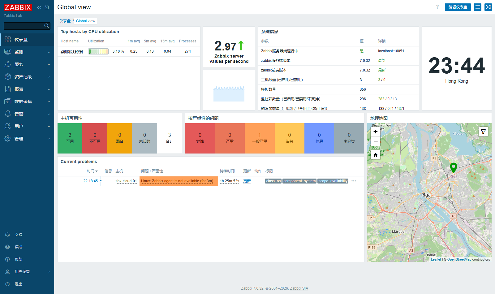

这一页有 6 个区块，逐个说：

**① Top hosts by CPU utilization（CPU 最高的主机）**

一行一台主机，`1am avg / 5m avg / 15m avg / Average` 四个平均负载值。

**运维看什么**：谁的 CPU 排第一。如果某台一直占着第一且数字很高（比如 80%+），就是有问题的。

**② NVPS —— 整个平台的心跳**

```
2.97 ↑
Zabbix server
Values per second
```

NVPS = **每秒新增多少个数据点**。你现在是 2.97，意思是平均每秒往数据库写 3 条数据。

**怎么算的**：75 个监控项 ÷ 60 秒 ≈ 1.25，加上其他主机的项，差不多就是 3。

**运维看什么**：
- 这个数**突然掉到 0** → 采集中断了，肯定出事了
- 这个数**突然暴涨** → 有人加了大量监控项，或者采集间隔被改短了
- **NVPS 是规划容量最重要的指标**：1 台 Server 大概能扛 3000–5000 NVPS（还要看硬件）

**③ 系统信息**

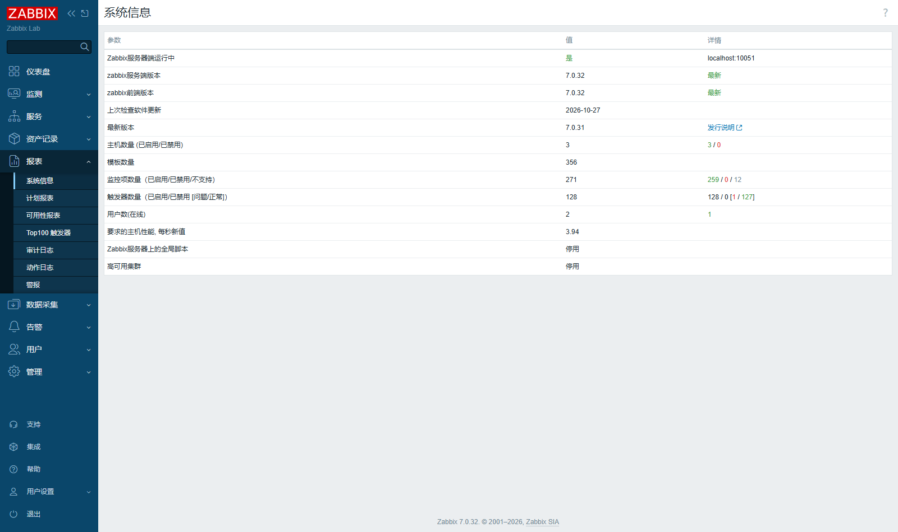

| 参数 | 你的值 | 含义 | 异常时说明什么 |
|------|--------|------|---------------|
| Zabbix 服务器端运行中 | 是 | Server 进程活着 | **"否" = 整个平台挂了**，最先看这条 |
| Zabbix 服务器版本 | 7.0.32 | — | — |
| 主机数量（已启用/已禁用） | 3 / 0 | 被监控机器数 | 数字和你预期不符 = 有人加了或禁了主机 |
| 模板数量 | 356 | 内置模板总数 | — |
| 监控项数量（已启用/禁用/不支持） | 259 / 0 / 12 | **不支持 = 采集出错的项** | ⚠️ "不支持"不为 0 就要查 |
| 触发器数量（已启用/禁用/问题/正常） | 128 / 0 / **1** / 127 | **问题 = 当前有 1 条告警** | 和 Problems 页对得上 |

> **"监控项不支持 12 个"这个数字要特别注意**。它的意思是"这些指标采不到值"。
> 点进去能看到具体是哪 12 个、报什么错。你这 12 个多半是 `zbx-cloud-01` 的（它连不上）。

**④ 主机可用性**

```
2 可用 | 1 不可用 | 0 混合 | 0 未知 | 合计 3
```

**运维看什么**：**"不可用"只要不是 0，就说明有机器失联**。点那个数字直接跳到问题列表。

**⑤ 按严重性的问题**

```
0 灾难 | 0 严重 | 1 一般严重 | 0 警告 | 0 信息 | 0 未分类
```

按 6 个等级统计当前告警数。**运维看什么**：有没有红色的（灾难/严重）。你现在那个 1 是"一般严重"。

**⑥ 当前问题**（列表）

时间 / 信息 / 主机 / 问题·严重性 / 持续时长 / 更新 / 动作 / 标记。

你现在有一条：`zbx-cloud-01` 的 `Linux: Zabbix agent is not available (for 3m)` —— **这就是那条真实告警**，第 6 章会带你定位它。

> 右上角还有个时钟和"地理地图"。地图要配经纬度才有用，学习阶段忽略。

---

### 2.2 问题（Problems）—— 出事了先来这里

`监测 → 问题`

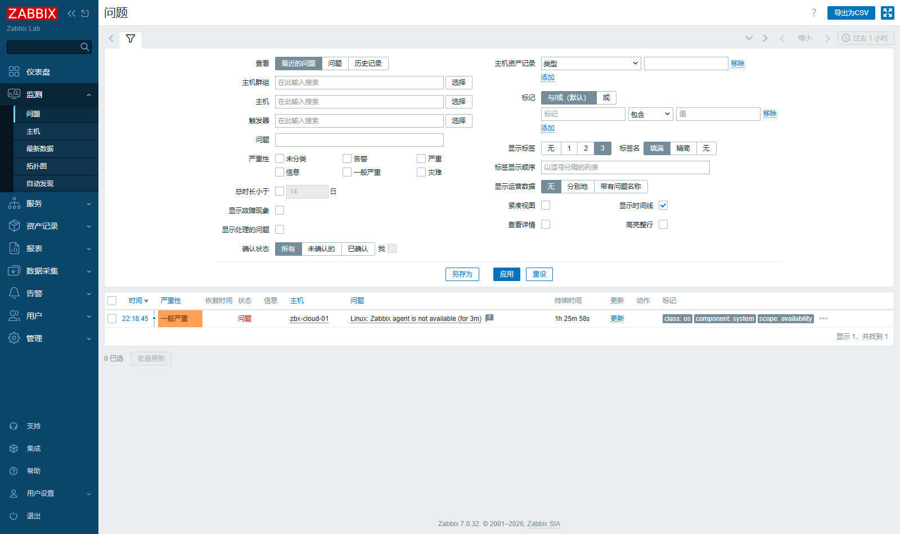

**三个视图切换（左上角"查看"）**：

| 视图 | 看什么 | 什么时候用 |
|------|--------|-----------|
| **最近的问题** | 最近 24h 内发生的（含已恢复） | ⭐ 日常默认 |
| **问题** | 只有**当前还没解决**的 | 想知道"现在还有什么没处理" |
| **历史记录** | 所有历史告警 | 复盘、写故障报告 |

**每一列怎么读**：

| 列 | 例子 | 含义 |
|----|------|------|
| 时间 | `22:18:45` | 告警**发生**的时间 |
| 严重性 | `一般严重` | 6 级之一，见下表 |
| 恢复时间 | （空） | 空了说明**还没恢复**；有值说明已自愈 |
| 状态 | `问题` | `问题` = 正在发生；`已解决` = 恢复 |
| 主机 | `zbx-cloud-01` | 哪台机器 |
| 问题 | `Linux: Zabbix agent is not available (for 3m)` | 告警名称，括号里是条件 |
| 持续时长 | `1h 3m 55s` | **已经持续了多久** ← 判断紧急程度看这个 |
| 更新 | `更新` | 点它可以加备注/确认 |

**6 个严重等级**（按运维响应速度给参考）：

| 等级 | 中文 | 典型场景 | 建议响应 |
|------|------|---------|---------|
| Not classified | 未分类 | 没设级别的自定义告警 | — |
| Information | 信息 | 有人登录、配置变更 | 不用管 |
| Warning | 警告 | 磁盘 80%、负载偏高 | 当天处理 |
| **Average** | **一般严重** | Agent 失联、磁盘 85% | **1 小时内** |
| **High** | **严重** | 服务不可用、磁盘 90% | **立刻** |
| **Disaster** | **灾难** | 整机宕机、核心业务中断 | **立刻，全员** |

**筛选器的实用技巧**：

- `严重性` 只勾"严重"和"灾难" → 过滤掉噪音，只看大事
- `确认状态` 选"未确认" → 只看没人处理过的
- `总时长小于` 改小 → 只看刚发生的（避免被老问题淹没）

**右上角"导出为 CSV"**：周报、故障报告直接用它拉数据。

---

### 2.3 主机（Hosts）—— 一眼扫完全局

`监测 → 主机`

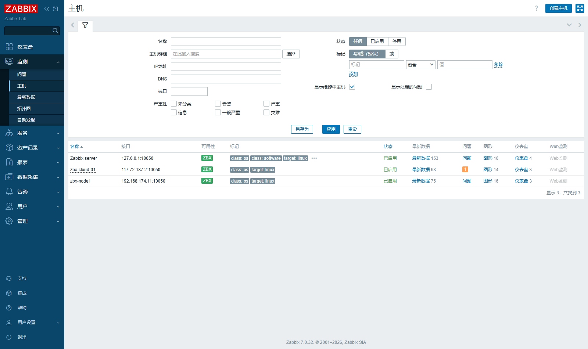

三行三台机器。每行看三样东西：

**① 可用性（ZBX 图标）**

| 图标 | 含义 | 怎么办 |
|------|------|--------|
| 🟢 绿 ZBX | 采集正常 | 没事 |
| 🔴 红 ZBX | **连不上 Agent** | 鼠标悬停看报错，见第 6 章 |
| ⚪ 灰 ZBX | 还没采集过 | 等 1 分钟；一直灰 = 配置有问题 |

**② 中间的迷你图（sparkline）**

CPU / 内存 / 磁盘 三条小曲线，**不用点进去就能看出有没有异常尖峰**。这是这个页面最有价值的地方。

**③ 行尾的四个链接**

| 链接 | 跳到哪 |
|------|--------|
| 最新数据 | 这台机器的所有指标（**最常用**） |
| 问题 | 这台机器的告警 |
| 图形 | 这台机器的所有图表 |
| 仪表盘 | 这台机器专属的图表墙 |

---

### 2.4 最新数据（Latest data）—— 定位具体指标

`监测 → 最新数据`，或者从主机列表点「最新数据」

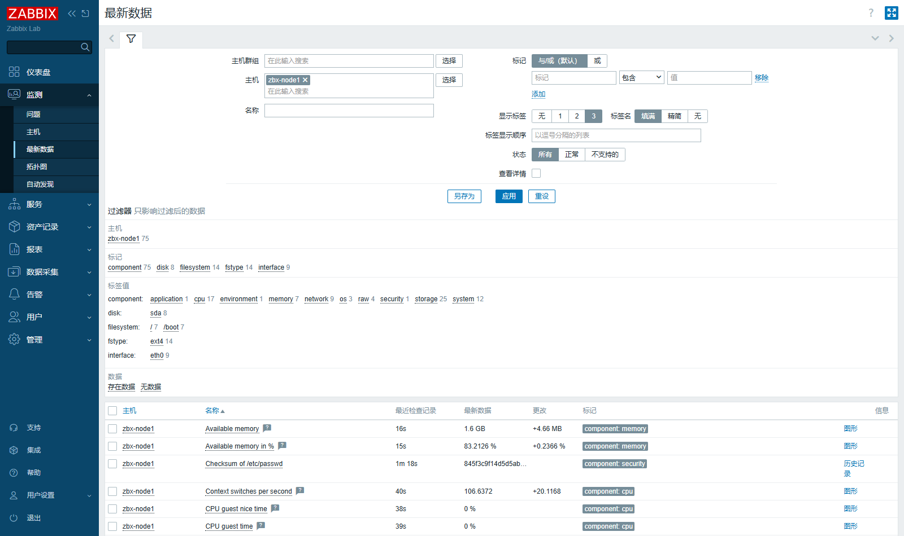

**页面结构（三块）**：

**① 筛选条**（顶上）

| 字段 | 用在哪 |
|------|--------|
| 主机群组 / 主机 | 选机器。**输入名字后要点下拉里的选项**，然后点"应用" |
| 名称 | 按指标名过滤，比如输入 `CPU` |
| 标记 | 按标签过滤，比如 `component: cpu` |
| 状态 | "所有 / 正常 / 不支持的" ← **选"不支持的"能揪出采不到值的指标** |

**② 过滤器详情**（中间那块统计）

```
主机 zbx-node1: 75        ← 这台机器一共 75 个指标
标记 component: 75  disk: 8  filesystem: 14  fstype: 14  interface: 9
```

这是**标签统计**。点 `disk: 8` 就只看磁盘相关的 8 个指标，比输入名字快。

**③ 数据表**（下面）

| 列 | 含义 | 运维关注点 |
|----|------|-----------|
| 主机 | 哪台机器 | — |
| 名称 | 指标名 | — |
| **最近检查记录** | 上次采集距今多久 | **超过采集间隔的 2 倍 = 采集卡住了** |
| **最新数据** | 当前值 | 结合第 3 章判断正常与否 |
| **更改** | 与上次的差 | 突然大幅变化值得注意 |
| 标记 | 标签 | 用来筛选 |
| 信息 | ⓘ 图标 / **图形图标** | **点图形图标直接看这条指标的曲线** |

**两个标签页**：`存在数据` / `无数据`。切到"无数据"能看出哪些指标从来没采到过。

> **最实用的一招**：勾选几行 → 点下面的 **"显示图形"**，把多条指标的曲线叠在一张图上看。
> 比如同时勾 CPU 和 Memory，就能看出是"CPU 高导致内存涨"还是反过来。

---

### 2.5 图形（Charts）—— 看趋势变化

`监测 → 图形`，或者从主机列表点「图形」

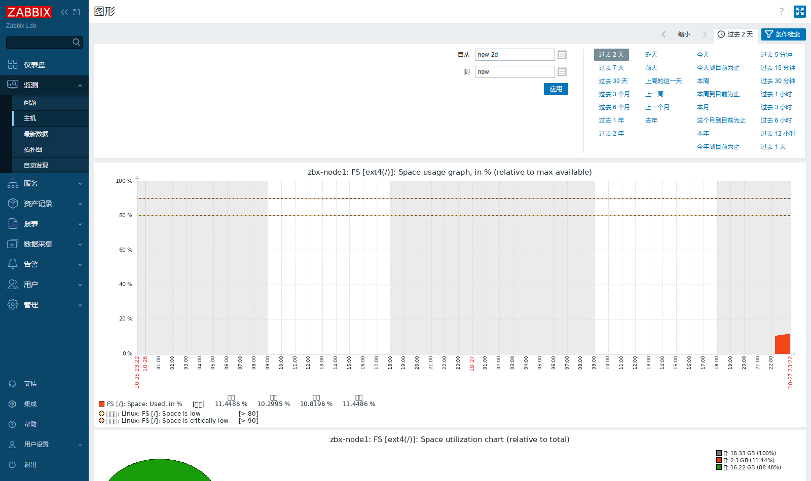

这是这台机器**所有预定义的图表**清单。点任意一个名字就打开曲线。

单条曲线的界面长这样（这就是你在 2.4 里点图形图标看到的）：


**图上的关键信息**：

```
左下角：CPU utilization [all]   last 0.30 %   min 0.26 %   avg 0.65 %   max 3.78 %
                                 ↑最新值       ↑最低        ↑平均        ↑最高
```

**运维看什么**：`max` 和 `avg` 的差距。
- max 很高但 avg 很低 → **偶发尖峰**，通常不用管
- max 和 avg 都高 → **持续高负载**，要处理

时间范围在左上角改，`now-1h` 表示"从 1 小时前到现在"。快捷按钮在右上角（`最近 1 小时` / `最近 2 天` / `最近 7 天`）。

**主机仪表盘**（主机行尾点「仪表盘」）是把常用图表拼成一屏，适合盯单台机器：

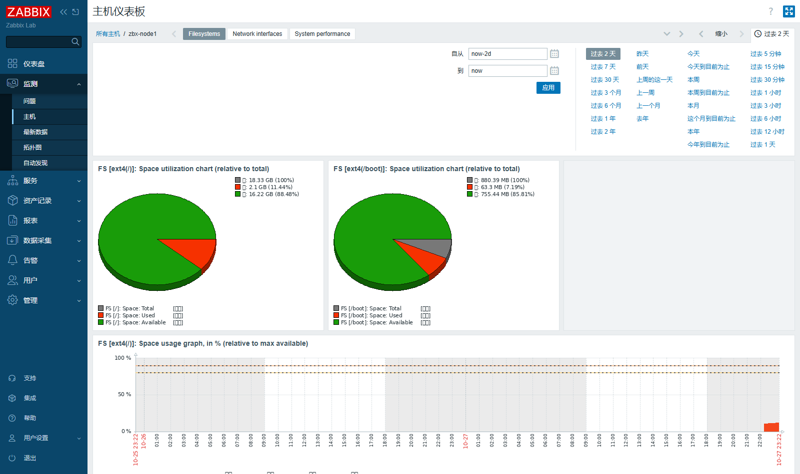

---

## 3. 指标怎么读（这一章最重要）

光会点不够，得知道**数字多少算正常**。下面按类别说。

### 3.1 CPU

| 指标 | Key | 正常范围 | 什么情况要管 |
|------|-----|---------|-------------|
| **CPU 使用率** | `system.cpu.util` | < 70% | 持续 > 80% 要查，> 90% 是告警线 |
| **1 分钟负载** | `system.cpu.load[all,avg1]` | **< 核数** | 超过核数 = 有任务在排队 |
| 上下文切换/秒 | `system.cpu.switches` | 几千到几万都正常 | 突增往往是进程/线程暴涨 |

**"负载"这个指标最容易看错**：它是个**绝对值，不是百分比**。

```
1 核机器：负载 1.0 = 刚好跑满，> 1.0 就是排队
4 核机器：负载 4.0 才算跑满，负载 1.0 只用了 25%
```

所以判断标准是 **负载 ÷ 核数**。Zabbix 的默认告警宏 `{$LOAD_AVG_PER_CPU.MAX.WARN}` 就是按"每核 1.5"设的。

你这个实验环境是 1 核，负载基本在 0，正常。

### 3.2 内存

| 指标 | Key | 正常范围 | 说明 |
|------|-----|---------|------|
| **内存使用率** | `vm.memory.utilization` | < 80% | > 90% 告警 |
| **可用内存** | `vm.memory.size[available]` | > 20% 总量 | 这个比"使用率"更准 |
| Swap 剩余 | `system.swap.size[,pfree]` | > 50% | **用上 swap 就是内存不够了** |

> **新手最容易误判的**：Linux 会主动把空闲内存拿去做缓存，所以"已用内存"看起来很高是**正常的**。
> 判断内存够不够，看 **available**（可用）而不是 **used**（已用）。
> 你这个环境的 available 是 1.7 GB / 2 GB，很健康。

### 3.3 磁盘

| 指标 | Key | 正常范围 | 说明 |
|------|-----|---------|------|
| **分区使用率** | `vfs.fs.size[/,pused]` | < 80% | 80% 警告、90% 严重 |
| **inode 使用率** | `vfs.fs.inode[/,pfree]` | 剩余 > 20% | **小文件多的场景会先把 inode 用光** |
| 磁盘读/写速率 | `vfs.dev.read.rate[sda]` | 看业务 | 突增排查 IO 密集操作 |
| **IO 等待时间** | `vfs.dev.read.await[sda]` | < 20 ms | 超过说明磁盘是瓶颈 |

> **磁盘满了不一定是空间问题，可能是 inode 用光了**。两者都要监控。
> 现象：`df -h` 显示还有空间，但 `df -i` 显示 inode 100%，此时无法创建新文件。

### 3.4 网络

| 指标 | Key | 说明 |
|------|-----|------|
| 入/出流量 | `net.if.in[eth0]` / `net.if.out[eth0]` | 单位 bps，注意是**比特**不是字节 |
| 链路状态 | `net.if.status[ifOperStatus]` | `Link down` 告警 = 网线掉了或对端关了 |

> **流量单位换算**：`net.if.in` 给的是 bps（比特/秒）。换算成常见的"兆"要除以 8 再除以 1,000,000。
> 比如 80,000,000 bps = 80 Mbps = 大约 10 MB/s 的下载速度。

### 3.5 系统

| 指标 | Key | 说明 |
|------|-----|------|
| 开机时长 | `system.uptime` | **突然变小 = 机器重启过**（很重要的告警线索） |
| 进程数 | `proc.num[,,run]` | 突增可能是进程泄漏 |

> **`uptime` 归零是个金矿**。很多"服务莫名挂了"的问题，其实是机器半夜重启了。
> 看到 uptime 突然从 30 天变成 5 分钟，就要去查 `last reboot`。

### 3.6 一张速查表（贴在工位上）

| 类别 | 指标 | 绿色 | 黄色 | 红色 |
|------|------|------|------|------|
| CPU | 使用率 | <70% | 70–90% | >90% |
| CPU | 负载/核数 | <1.0 | 1.0–1.5 | >1.5 |
| 内存 | 可用占比 | >30% | 20–30% | <20% |
| 内存 | Swap 使用 | 0 | <50% | >50% |
| 磁盘 | 分区使用率 | <80% | 80–90% | >90% |
| 磁盘 | inode 剩余 | >20% | 10–20% | <10% |
| 磁盘 | IO await | <10ms | 10–20ms | >20ms |

> 这些阈值和 Zabbix 默认模板里的宏是一致的，想改就改宏（见《使用手册》4.2）。

---

## 4. 其余菜单逐个点一遍

不用背，知道"出什么问题该去哪"就行。

### 4.1 数据采集（Data collection）—— 改配置的地方

这是**唯一一个"写"的菜单**，其他都是"看"。

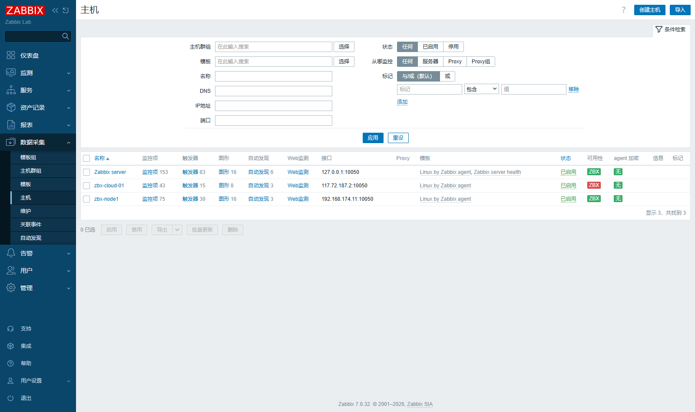

| 子菜单 | 干什么 | 什么时候用 |
|--------|--------|-----------|
| 模板组 / 主机群组 | 分组管理 | 主机多了以后整理用 |
| **模板** | 一堆监控项+触发器的打包 | ⚠️ 别乱改，全局共用 |
| **主机** | 加机器、改宏、挂模板 | ⭐ 加新机器来这 |
| **维护** | 设置维护期，期间不报警 | ⭐ 计划内变更前必做 |
| 关联事件 | 事件合并规则 | 高级，抑制告警风暴 |
| 自动发现 | 自动扫描网段 | 大规模环境用 |

**点主机名进去**，顶部一排标签是：

```
主机 | IPMI | 标记 | 宏 | 资产记录 | 加密 | 值映射
```

改阈值就点 **宏**（这是最推荐的改法，不影响别的机器）。

### 4.2 监控项与触发器（在主机行尾）

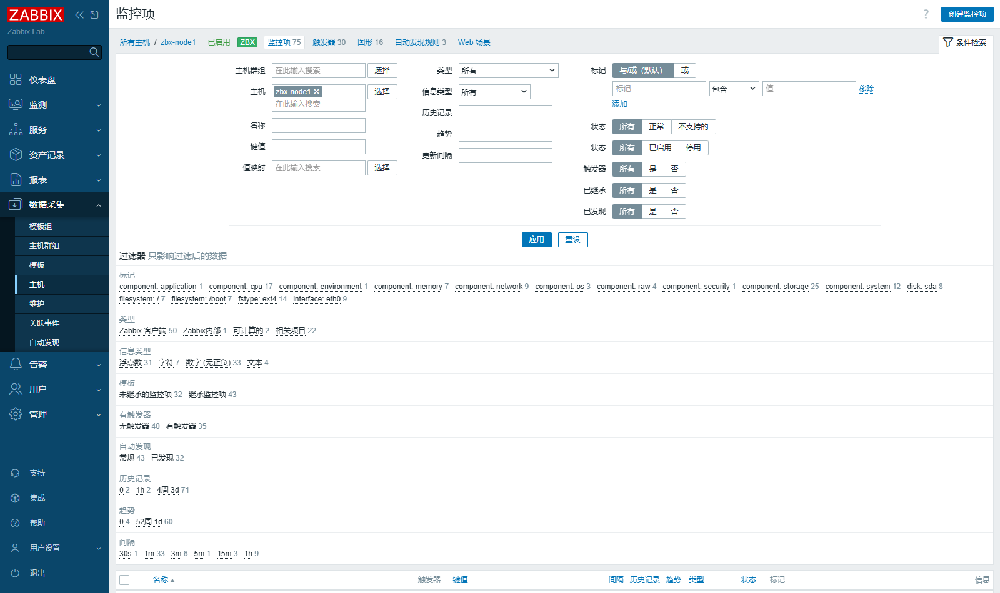

**监控项列表**：一行一个指标。重点看三列——

- `键值`：真实的采集命令，比如 `system.cpu.util`
- `间隔`：多久采一次
- `状态`：已启用 / **不支持**（采不到值）

点某个指标的名字进去，能看到完整配置：

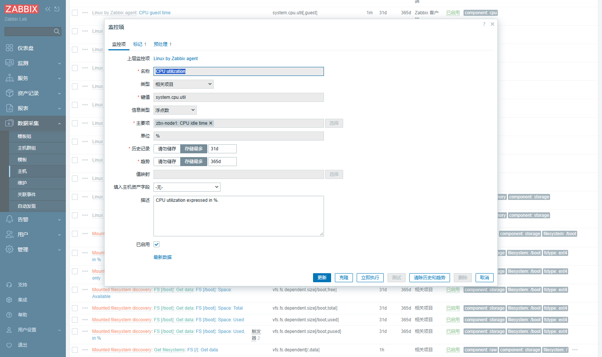

**触发器列表**：

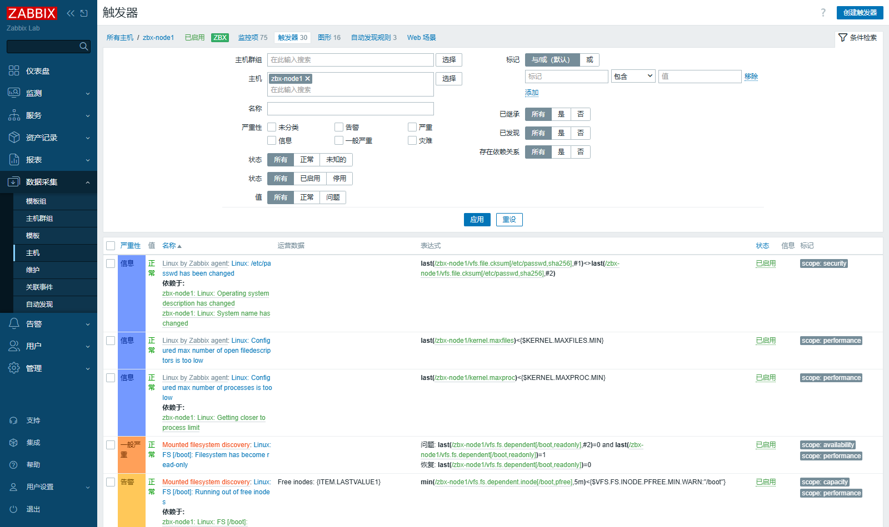

一行一条规则，`严重性` 列就是告警等级。点名字进去看表达式：

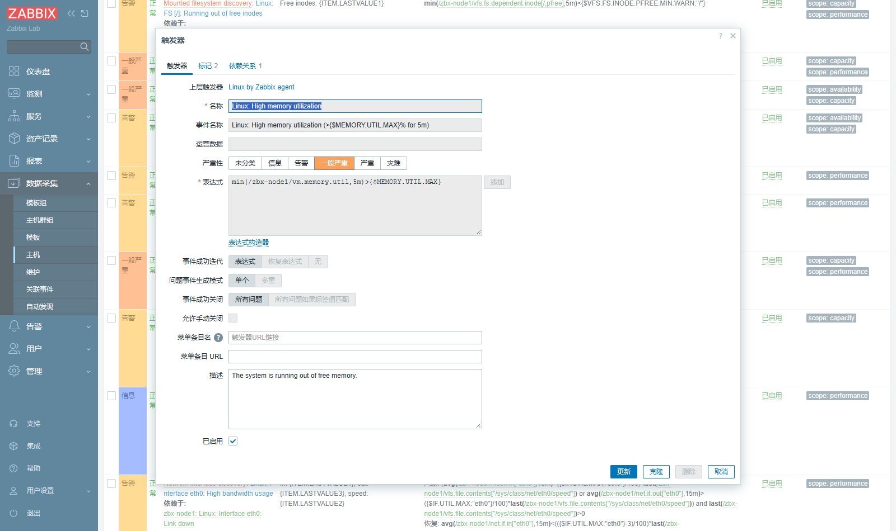

**这张图值得多看几眼**，它把"触发器"讲全了：

| 字段 | 图上的值 | 含义 |
|------|---------|------|
| 名称 | `Linux: High memory utilization` | 告警叫什么 |
| 事件名称 | `... (> {$MEMORY.UTIL.MAX}% for 5m)` | 报警时显示的完整描述 |
| 严重性 | 一般严重（橙） | 6 级之一 |
| **表达式** | `min(/zbx-node1/vm.memory.util,5m)>{$MEMORY.UTIL.MAX}` | **核心**，见下面的拆解 |
| 描述 | `The system is running out of free memory.` | 给人看的解释 |
| 已启用 | ✅ | 取消勾选就临时关掉这条告警 |

**表达式怎么读**（这是新手最大的坎，拆开就懂了）：

```
min ( /zbx-node1/vm.memory.util , 5m )  >  {$MEMORY.UTIL.MAX}
 │        │            │          │          │
 │        │            │          │          └─ 阈值，取宏的值（=90）
 │        │            │          └─ 时间窗口：最近 5 分钟
 │        │            └─ 取哪个指标（这台机器的内存使用率）
 │        └─ 哪台主机（主机技术名）
 └─ 函数：min = 取这段时间内的最小值
```

**整句意思**：*"最近 5 分钟内，内存使用率的最小值 > 90%，就报警"*。

用 `min` 而不是 `last` 是为了**防抖**——避免内存一秒冲到 90% 就报一次警。

### 4.3 模板

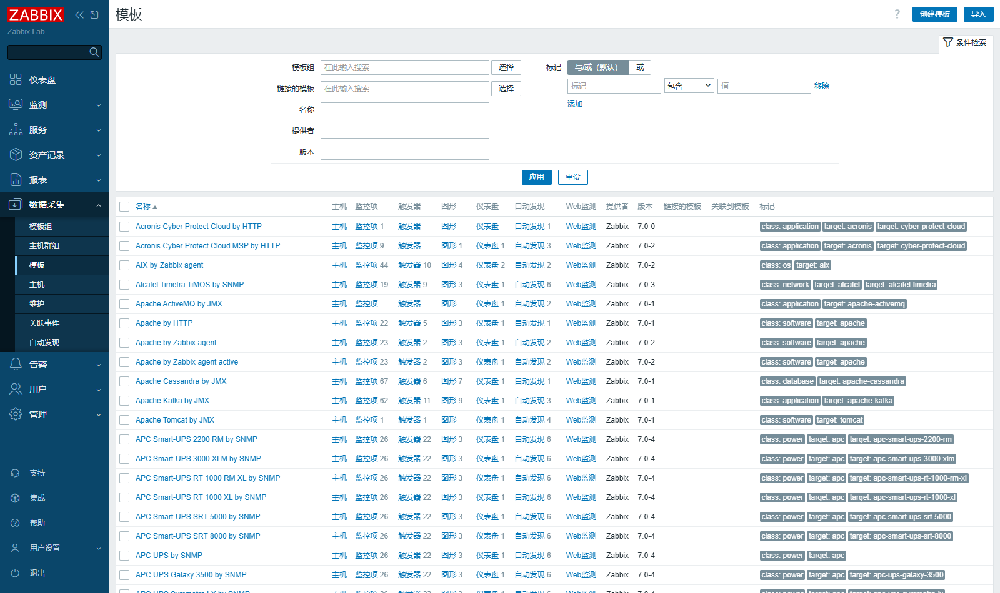

356 个内置模板，覆盖 Linux / Windows / 交换机 / 数据库 / 云服务…

**运维怎么用**：不是自己写，而是**挂现成的**。加一台 Linux 机器就挂 `Linux by Zabbix agent`，几百个指标和触发器一次性到位。

### 4.4 维护

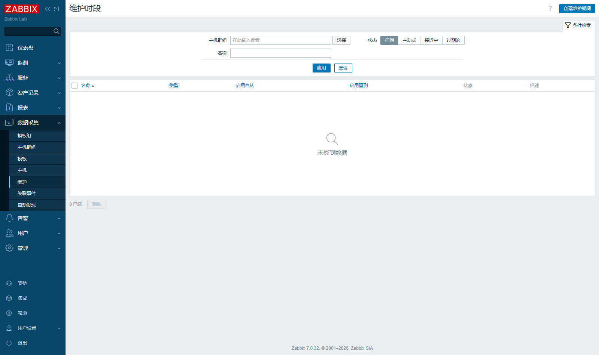

**这是运维最该养成习惯的功能**。要做变更（重启、升级、迁移）之前，先建一个维护期：

- 期间**不产生告警**（不会半夜被叫起来）
- 但**数据照常采集**（事后还有曲线看）
- 到时间自动结束，不用手动关

### 4.5 告警（Alerts）—— 通知怎么发出去

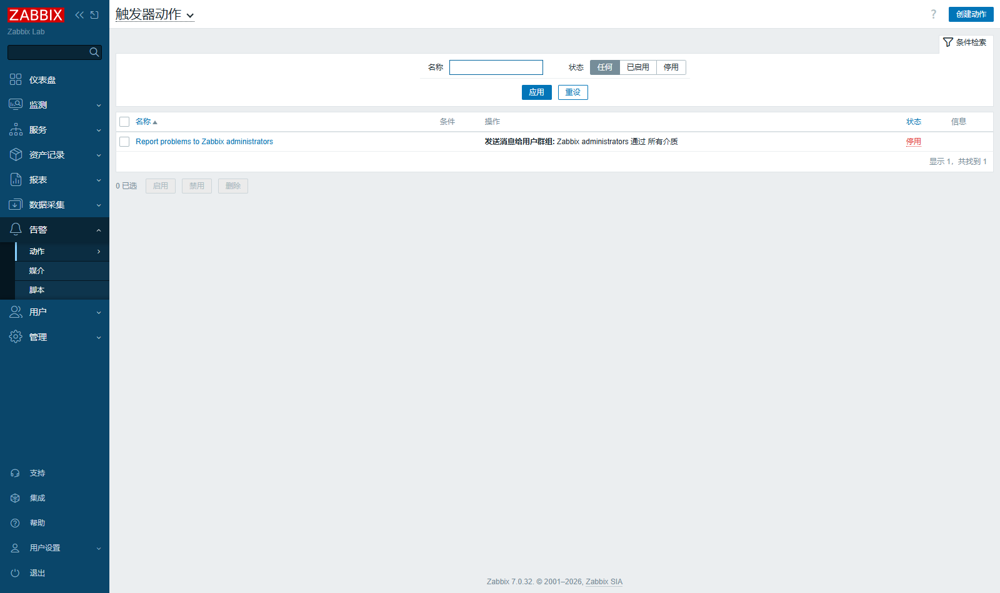

| 子菜单 | 干什么 |
|--------|--------|
| **触发器动作** | 什么条件下、发给谁、发几次 ← **最常用** |
| 服务动作 / 发现动作 / 自动注册动作 / 内部动作 | 其他场景的通知 |
| **媒介** | 用**什么通道**发：邮件 / Webhook / 短信 |
| 脚本 | 告警时可以在服务器上执行的脚本 |

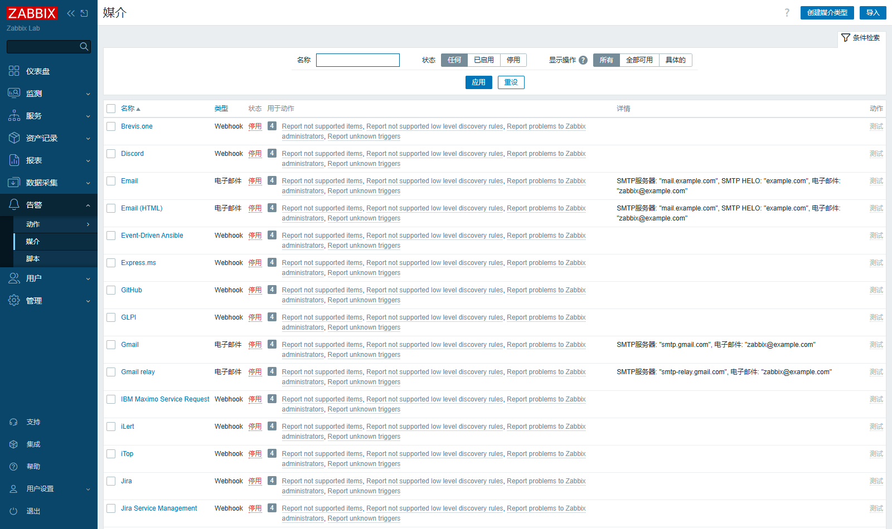

**"为什么我没收到告警？"** 按这个顺序查：

```
① 触发器动作存在吗？（条件匹配了没）
② 动作里配了"发送给用户组"吗？
③ 那个媒介类型启用了吗？（Email 默认是禁用的）
④ 用户的"媒介"标签里配了这个通道吗？
⑤ 用户群组的权限能看到这台主机吗？
```

四个环节缺一个都收不到。这是最高频的"配置了但不生效"问题。

### 4.6 用户

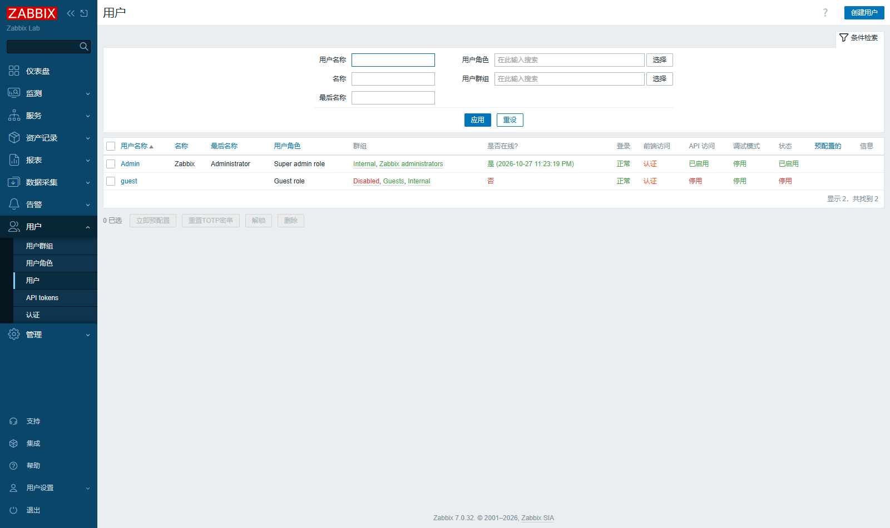

| 子菜单 | 说明 |
|--------|------|
| 用户群组 | 权限是按**群组**给的，不是按人 |
| 用户角色 | 能操作什么（只读 / 运维 / 管理员） |
| 用户 | 账号本身 |
| API 令牌 | 程序调用接口用 |
| 认证 | 对接 LDAP / SAML 单点登录 |

### 4.7 管理（Administration）—— 排障与全局设置

| 子菜单 | 干什么 | 什么时候用 |
|--------|--------|-----------|
| 一般 | 时区、默认语言、密码策略 | 初始化时配一次 |
| **清理（Housekeeping）** | 数据保留期 | ⭐ 磁盘快满时来改 |
| 代理 | Zabbix Proxy 管理 | 大规模环境 |
| 宏 | **全局宏** | 想给所有主机统一改阈值时 |
| **队列** | 采集积压情况 | ⭐⭐ **性能排障必看** |
| 图标映射 | 自定义图标 | 美化，可跳过 |

**队列（Queue）** 是最容易被忽略但很重要的页面：

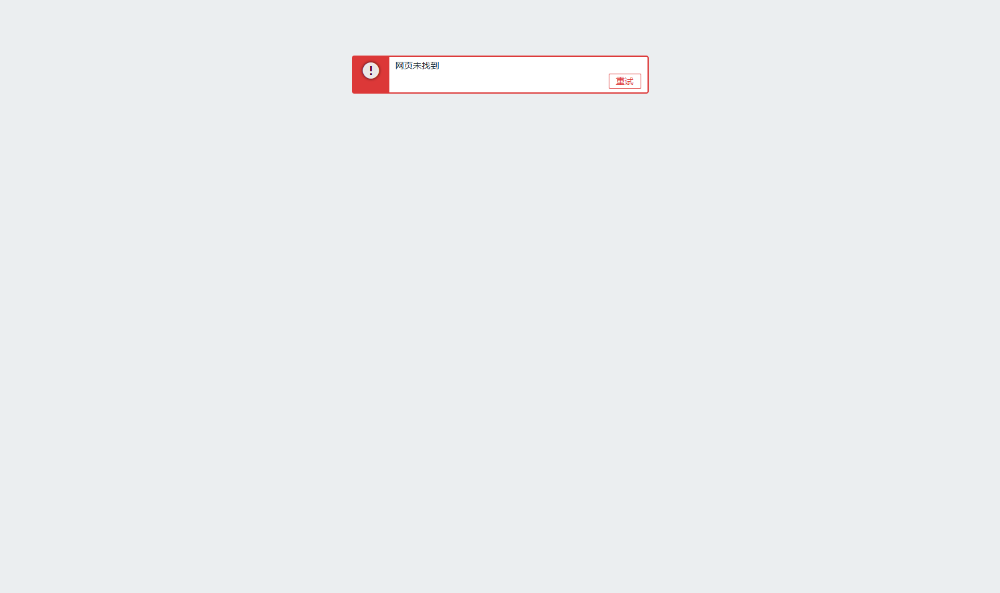

它显示"有多少监控项在排队等待采集"。**正常应该是空的**（或只有极少数）。

如果积压几百上千，说明 **Server 采集能力不够**（pollers 太少、数据库慢、网络延迟高）。这时候的表现是：网页上数据延迟、曲线断断续续。

**清理（Housekeeping）**：

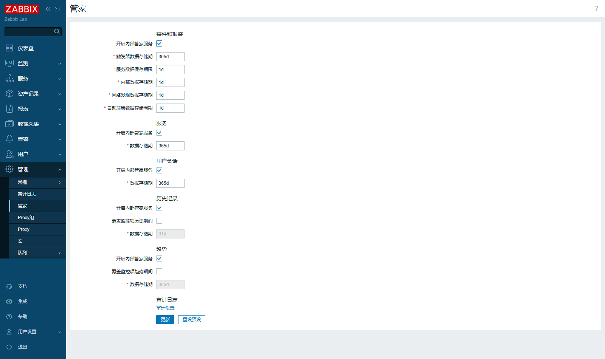

| 项目 | 默认 | 改它的依据 |
|------|------|-----------|
| 历史数据保留 | 31 天 | 磁盘紧张改 7–15 天 |
| 趋势数据保留 | 365 天 | 想保留一年趋势就留着 |
| 是否启用 | ✅ | ⚠️ 关掉的话数据库会无限增长 |

### 4.8 报表（Reports）

| 子菜单 | 用途 |
|--------|------|
| **系统信息** | 见 2.1 ③，看整体健康度 |
| 可用性报表 | 某台主机某段时间的"在线率"（写 SLA 报告用） |
| **Top 100 触发器** | 哪条告警最频繁 ← **优化告警的入口** |
| 审计日志 | 谁改了配置 |
| 动作日志 | 告警发了没、发给谁了 |
| 警报 | 历史告警明细 |
| 计划报表 | 定时发邮件报表 |

> **Top 100 触发器特别有用**：如果某条告警一天触发 50 次，要么是阈值不合理，要么是真有问题。
> 排在最前面的那几条，就是最该处理的。

### 4.9 服务 / 资产记录

- **服务（Services）**：按业务视角组织（比如"订单系统 → Web层 + DB层"），某层挂了能看出影响了哪个业务。小环境用不上。
- **资产记录（Inventory）**：记机房位置、机型号、负责人、保修期。设备多了才有价值，现在是空的。

---

## 5. 运维的日常节奏

**知道看什么之后，还要知道"什么时候看什么"**。

### 5.1 每天（5 分钟）

```
① 打开 仪表盘 → 扫一眼"主机可用性"是不是 3/3，有没有红色严重告警
② 看"按严重性的问题"里 灾难/严重 是不是 0
③ 进 问题 → 筛选"未确认" → 处理掉或 Ack 掉
```

三条都正常，就可以干别的了。

### 5.2 每周（20 分钟）

```
① 报表 → Top 100 触发器 → 看哪条告警最吵，判断是阈值问题还是真故障
② 管理 → 队列 → 确认没有积压
③ 报表 → 可用性报表 → 哪台机器这周掉线最多
④ 仪表盘 → 系统信息 → "监控项不支持"的数字有没有变大
```

### 5.3 每月

```
① 清理（Housekeeping）→ 看数据库增长 /var/lib/mysql/zabbix 多大
② 复核阈值：业务变了，80% 可能已经不合理
③ 清掉不用的主机和模板，减小噪音
```

### 5.4 收到告警时的标准动作（SOP）

这是**最重要的一段**，照着做不会乱：

```
第 1 步：看告警名称，判断类型
         "Agent is not available" → 连不上，去查网络/进程
         "High memory utilization" → 资源问题，去查进程
         "FS ... critically low"   → 磁盘，去删文件或扩容

第 2 步：看"持续时长"
         3 分钟的 → 可能是抖动，观察一下
         3 小时的 → 真问题，立刻处理

第 3 步：进 监测 → 主机，看这台机器的 ZBX 图标

第 4 步：点行尾"最新数据"，看"最近检查记录"
         时间停在几分钟前 = 采集断了
         时间在几秒内 = 采集正常，问题在被监控的服务本身

第 5 步：点"图形"，把时间范围拉到出事前后，看曲线形状
         断崖式 = 突然故障     缓慢上升 = 资源耗尽

第 6 步：SSH 上机器，用命令行验证（top / free -m / df -h）

第 7 步：在 Problems 里 Ack 一下，写上你查到的东西
         解决问题后，Zabbix 会自动把它变成"已解决"
```

---

## 6. 拿你环境里的真实告警练一遍

> 这一章记录的是 **2026-10-27 晚上真实发生的一次排障**，从"红"到"绿"用了约 20 分钟。
> **重要**：下面截图里现在是三台全绿（因为问题已解决），但当时 `zbx-cloud-01` 是红的。
> 这段过程之所以值得看，是因为**第一次尝试（加安全组）是失败的**——而"失败"才是真实运维的日常。

你现在正好有一条**真实告警**，跟着走一遍就全懂了。

### 6.1 现状

```
主机：zbx-cloud-01（117.72.187.2，京东云那台）
告警：Linux: Zabbix agent is not available (for 3m)
严重性：一般严重
持续时长：1h 3m 55s
```

### 6.2 按 SOP 排查

**第 1 步：告警名称说"Agent 不可用"** → 这是"连不上"，不是"服务器资源问题"。

**第 2 步：持续 1 小时** → 不是抖动，是真问题。

**第 3 步：进 监测 → 主机** → `zbx-cloud-01` 是红 ZBX。鼠标悬停能看到：

```
Get value from agent failed: cannot establish TCP connection to [117.72.187.2]:10050
```

这句话已经指明了：**TCP 连不上 10050 端口**。

**第 4 步：谁来连谁？** Zabbix Server（在本地 VMware）主动去连云主机的 10050。所以问题是"本地到云主机的 10050 不通"。

**第 5 步：在 zbx-server 上看"最新数据"** → `zbx-cloud-01` 所有指标的"最近检查记录"都停在很久以前，确认是采集断了。

**第 6 步：上服务器验证**（SSH 到 `192.168.174.10`）：

```bash
timeout 5 bash -c 'cat < /dev/null > /dev/tcp/117.72.187.2/10050' && echo OPEN || echo CLOSED
# 结果：CLOSED
```

**第 7 步：分层定位（第一轮）**

| 检查项 | 命令 / 位置 | 结果 | 结论 |
|--------|------------|------|------|
| 网络通不通 | `ping 117.72.187.2` | 通 | 网络没问题 |
| 云主机 agent 活着吗 | 在云主机 `systemctl status zabbix-agent2` | active | agent 没问题 |
| 云主机在听 10050 吗 | 在云主机 `ss -tlnp \| grep 10050` | `*:10050` | 服务没问题 |
| 云主机自己防火墙 | `ufw status` / `iptables -L INPUT -n` | inactive / ACCEPT | 没挡 |
| 云主机公网 IP | `curl ifconfig.me` | `117.72.187.2` | 和 Zabbix 配置一致 |

**六项全过**。机器侧完全正常，问题一定在云平台层。

**第 8 步：加了规则，还是不通**（关键转折）

第一次在京东云「安全组」里加了一条入站规则：

```
协议 TCP   端口 10050   源 0.0.0.0/0   策略 允许
```

等了两分钟，**依然 CLOSED**。

这时候要做一个很重要的鉴别测试——**换个端口试**：

```bash
# 从 Zabbix 服务器测云主机的 22 端口（SSH）
timeout 5 bash -c 'cat </dev/null >/dev/tcp/117.72.187.2/22'    && echo OPEN || echo CLOSED
# → OPEN

# 测 10050
timeout 5 bash -c 'cat </dev/null >/dev/tcp/117.72.187.2/10050' && echo OPEN || echo CLOSED
# → CLOSED
```

**22 通、10050 不通**，说明网络链路本身没断，是"针对 10050 的那条规则没起作用"。

**第 9 步：抓包，一锤定音**

这一步是整晚最有价值的操作。在云主机上抓包，同时从 Zabbix 服务器发起连接：

```bash
# 云主机上（先装：apt install tcpdump）
sudo timeout 25 tcpdump -ni any 'tcp port 10050' -c 20

# 与此同时，在 Zabbix 服务器上
timeout 4 bash -c 'cat </dev/null >/dev/tcp/117.72.187.2/10050'
```

结果：

```text
0 packets captured
0 packets received by filter
```

**"0 个包"这句话的含金量极高**，它直接排除了半壁江山：

| 抓到的包 | 说明 | 往哪查 |
|---------|------|--------|
| 有 SYN，没有 SYN-ACK | 请求到了机器，机器没回 | 机器上的 iptables / ufw / 服务 |
| 只有 SYN，回了 RST | 机器收到了，但端口没开 | Agent 没启动或监听地址不对 |
| **一个包都没有** | **请求在半路就被丢了，根本没到机器** | **云平台：安全组 / 网络 ACL / 防火墙** |

我们是第三种 → **平台层拦截，而且不是刚才加的那个安全组**。

**第 10 步：找到真正的拦截点**

翻遍了控制台才发现：**京东云的「轻量云主机」用的是「防火墙」，不是「安全组」**。

这是两个**完全独立**的机制，规则不互通：

| 产品类型 | 用哪个 |
|---------|--------|
| 云服务器（ECS / 标准云主机） | 安全组 |
| **轻量云主机（ Lighthouse 类）** | **防火墙** ← 我们这台是这种 |

**在安全组里加规则，对轻量云主机完全不生效。** 你在安全组页面能看到规则、显示"已添加"，但流量根本不走那儿。

正确路径：

```text
控制台 → 轻量云主机 → 选实例 → 防火墙 → 添加规则
    应用类型：自定义
    协议：TCP
    端口：10050
    源 IP：你的出口公网 IP/32     ← 别用 0.0.0.0/0
```

**第 11 步：验证**

```text
TCP 10050              → OPEN          ✅
zabbix_get agent.ping  → 1             ✅
Zabbix 主机列表         → 变绿（约 1 分钟后）✅
监控项                  → 68 个，其中 65 个有真实数据
```

23:33 加安全组规则（无效）→ 23:41 加防火墙规则 → 23:44:21 变绿。**从"不通"到"绿"只用了 3 分钟，但前面找错地方花了 8 分钟。**

### 6.3 这个案例教会你什么

**① 看告警要先分类**。三类问题的排查路径完全不同：

| 告警类型 | 典型名称 | 从哪里查起 |
|---------|---------|-----------|
| **连不上** | Agent is not available / Timeout | 网络、端口、防火墙、进程 |
| **资源不够** | High CPU / Memory / FS low | 进程、日志、扩容 |
| **服务异常** | Service down / Port not listening | 应用日志 |

**② "连不上"永远先查三层**：网络（ping）→ 端口（/dev/tcp 或 telnet）→ 进程（systemctl）。

**③ 抓包是网络问题的"金标准"**。所有软件层面的猜测，一抓包全部证伪。
`0 packets` 和 `有 SYN 无 SYN-ACK` 指向两个完全不同的方向，能省掉大量瞎试。

**④ 云厂商的"防火墙"和"安全组"可能是两套东西**。加完规则不通，第一反应应该是
"**我是不是改错地方了**"，而不是"规则没生效/云厂商有 bug"。
去实例详情页看它到底绑的是哪一个。

**⑤ 别图省事开 `0.0.0.0/0`**。Agent 暴露在公网，任何人都能拉你的系统信息；
以后要是配了 `system.run[]` 这类可执行命令的 Key，等于白送一个远程执行入口。
家宽 IP 会变，变了回来改一下就好，成本很低。

---

## 7. 速查：什么问题去哪个页面

| 我想…… | 去这里 |
|---------|--------|
| 看现在有没有事 | 监测 → 问题 |
| 看整体健康度 | 仪表盘 |
| 看某台机器所有指标 | 监测 → 主机 → 行尾"最新数据" |
| 看某个指标的历史曲线 | 最新数据 → 勾选 → 显示图形 |
| 看某台机器所有图表 | 监测 → 主机 → 行尾"图形" |
| 查"为什么这条指标没数据" | 最新数据 → 状态选"不支持的" |
| 改告警阈值 | 数据采集 → 主机 → 点名字 → **宏** |
| 改采集间隔 | 数据采集 → 主机 → 行尾"监控项" → 点名字 |
| 改报警条件 | 数据采集 → 主机 → 行尾"触发器" → 点名字 |
| 加一台新机器 | 数据采集 → 主机 → 创建主机 |
| 做变更不想被报警 | 数据采集 → 维护 |
| 配告警通知 | 告警 → 触发器动作 + 媒介 |
| 查性能问题 | 管理 → 队列 + 报表 → 系统信息 |
| 磁盘要满了 | 管理 → 清理 |
| 看哪条告警最吵 | 报表 → Top 100 触发器 |
| 看谁改了配置 | 报表 → 审计日志 |

---

## 8. 三个"看着像问题其实不是"的现象

**① 内存使用率 90% 但机器很健康**
Linux 会拿空闲内存做缓存。看 **available** 而不是 **used**。缓存会在需要时自动释放。

**② 某个指标"最近检查记录"是 30 秒前，但采集间隔是 1 分钟**
正常。Zabbix 采集不是精确对齐整分钟的，会有几秒浮动。只要不超过间隔的 2 倍就没问题。

**③ 告警一会儿出现一会儿消失**
触发器有"恢复表达式"，值回到阈值下就会自动 Resolved。如果频繁抖动，说明阈值设得太贴近日常波动：

- 加大"持续时间"（比如从 1m 改成 5m）
- 或者用 `avg()` 代替 `last()`

---

> **最后一句**：Zabbix 界面功能很多，但日常真正要看的就 5 个页面。
> 剩下的用到再学，别一开始就想全学会——**先能看懂"这台机器正不正常"，就够用了。**
